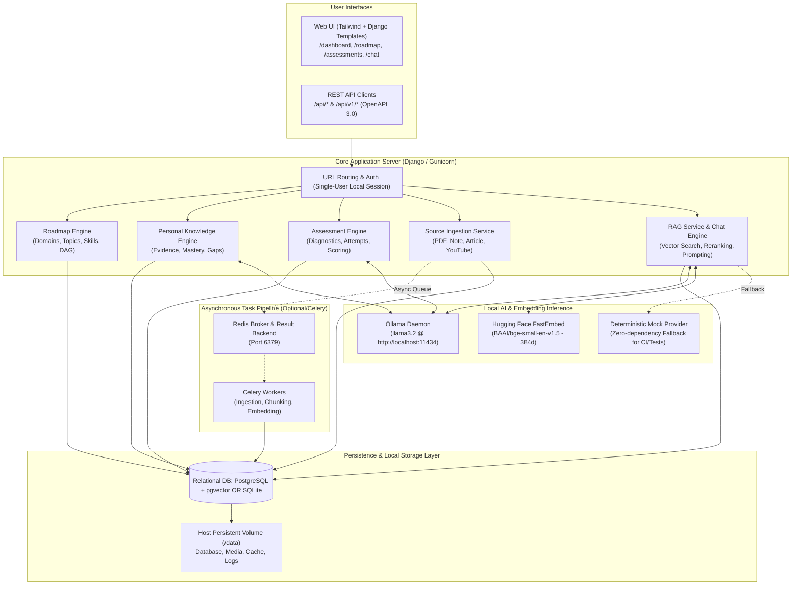
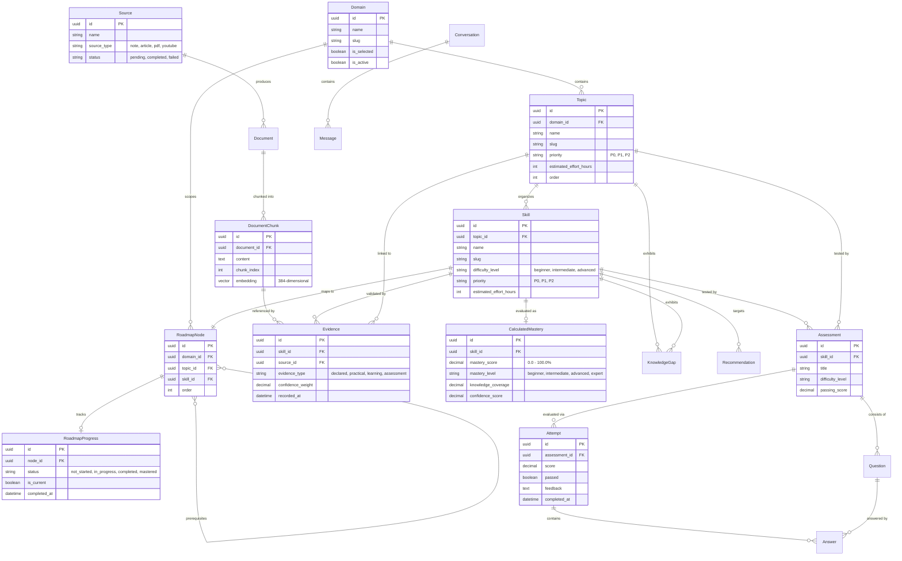
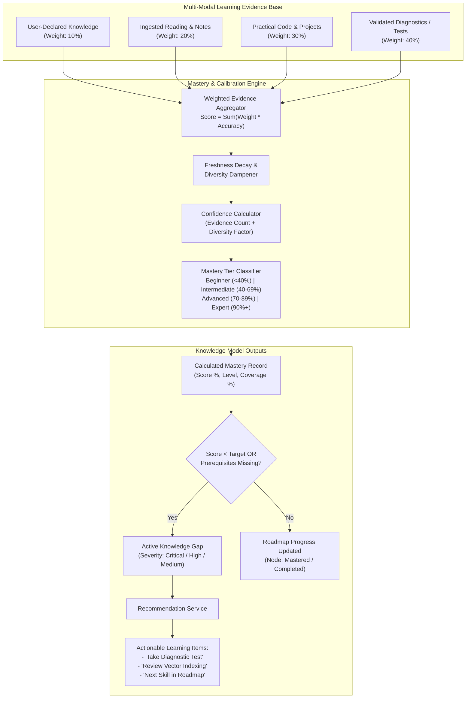

# Brofessor 🧠

> **Brofessor** is a local-first, privacy-respecting Personal Knowledge System (PKS) and AI learning assistant designed to transform fragmented learning materials into structured knowledge, personal mastery tracking, and grounded conversational discovery.

---

## Table of Contents

- [Overview](#overview)
- [System Architecture](#system-architecture)
  - [High-Level Architecture Diagram](#high-level-architecture-diagram)
- [Database Architecture](#database-architecture)
  - [Entity Relationship (ER) Diagram](#entity-relationship-er-diagram)
- [RAG Pipeline Architecture](#rag-pipeline-architecture)
  - [RAG Workflow Diagram](#rag-workflow-diagram)
- [Knowledge Model Architecture](#knowledge-model-architecture)
  - [Evidence & Mastery Flow Diagram](#evidence--mastery-flow-diagram)
- [Technology Stack](#technology-stack)
- [Project Directory Structure](#project-directory-structure)
- [Setup Instructions](#setup-instructions)
  - [Option A: Standalone Single Docker Container (Recommended)](#option-a-standalone-single-docker-container-recommended)
  - [Option B: Local Python Development Setup](#option-b-local-python-development-setup)
  - [Option C: Multi-Container Stack (Docker Compose)](#option-c-multi-container-stack-docker-compose)
- [Running Automated Tests](#running-automated-tests)
- [REST API Reference](#rest-api-reference)
- [Key Technical Decisions](#key-technical-decisions)
- [Troubleshooting & FAQ](#troubleshooting--faq)

---

## Overview

Brofessor acts as an intelligent academic mentor and study partner for software engineers, students, and lifelong learners. Instead of treating study notes and documentation as passive bookmarks, Brofessor:

1. **Ingests Diverse Content**: Raw notes, web articles, PDFs, YouTube transcripts, and markdown curricula.
2. **Normalizes, Chunks & Embeds**: Uses deterministic recursive splitting and local dense embeddings (384-dimensional `bge-small-en-v1.5` or Ollama).
3. **Retrieves with Grounded RAG**: Implements hybrid vector search with reciprocal reranking and strict citation provenance before synthesis.
4. **Maintains a Personal Knowledge Model**: Extracts concepts, technologies, and skills, mapping them into structured learning roadmaps (`Domain → Topic → Skill → RoadmapNode`).
5. **Evaluates Mastery & Detects Gaps**: Generates dynamic diagnostics (MCQ, conceptual, code questions), scores learner attempts, calculates multi-source weighted mastery, and highlights critical knowledge gaps with actionable next steps.

---

## System Architecture

Brofessor is designed around a modular, decoupled architecture where presentation, domain logic, asynchronous task processing, persistence, and local AI engines interact cleanly.

### High-Level Architecture Diagram



---

## Database Architecture

The relational schema strictly separates raw ingested evidence from calculated mastery metrics, while maintaining a hierarchical curriculum DAG (`Domain → Topic → Skill`).

### Entity Relationship (ER) Diagram



---

## RAG Pipeline Architecture

Brofessor utilizes a grounded, multi-stage Retrieval-Augmented Generation pipeline. Retrieval combines dense vector search with lexical reranking and citation tracking to prevent hallucinations.

### RAG Workflow Diagram

```mermaid
flowchart LR
    subgraph Ingestion["1. Document Ingestion"]
        RawDoc["Raw Input\n(PDF / Note / Article / Video)"]
        Parser["Text Extractor &\nSanitizer"]
        Chunker["Recursive Splitter\n(500 tokens, 50 overlap)"]
        EmbedGen["Embedding Model\n(bge-small 384d)"]
        VecStore[("Vector DB\npgvector / SQLite")]

        RawDoc --> Parser --> Chunker --> EmbedGen --> VecStore
    end

    subgraph Query["2. Query Processing & Retrieval"]
        UserQ["User Prompt"]
        QEmbed["Query Normalizer &\nEmbedding"]
        VectorSearch["Cosine Similarity Search\n(Top-K Candidates: 10)"]
        Reranker["Reciprocal Rank Fusion\n(Vector + Lexical Reranker)"]
        TopChunks["Top Grounded Chunks\n(Top-N: 4, Budget: 4k chars)"]

        UserQ --> QEmbed --> VectorSearch
        VecStore -.-> VectorSearch
        VectorSearch --> Reranker --> TopChunks
    end

    subgraph Generation["3. Synthesis & Attribution"]
        PromptAssembler["Grounded System Prompt\n(Context + Constraints)"]
        LLM["Local LLM Engine\n(Ollama: llama3.2)"]
        Attribution["Citation Engine\n[Doc:Chunk#]"]
        FinalAnswer["Verified Grounded Answer\n+ Interactive Citations"]

        TopChunks --> PromptAssembler
        UserQ --> PromptAssembler
        PromptAssembler --> LLM --> Attribution --> FinalAnswer
    end
```



---

## Knowledge Model Architecture

The Personal Knowledge Model separates raw empirical evidence from computed mastery metrics. It computes a unified score, identifies gaps, and generates targeted remediation recommendations.

### Evidence & Mastery Flow Diagram



---

## Technology Stack

| Layer | Component | Description |
|---|---|---|
| **Backend Framework** | Django 5.x & Django REST Framework | Clean REST API design, modular app architecture, ORM |
| **Database** | SQLite3 (Single Container) / PostgreSQL 16 + pgvector | Relational schemas + 384-dimensional cosine vector indexing |
| **Async Tasks & Queues** | Celery 5.x & Redis 7.x (Optional) | Non-blocking ingestion, chunking, and background vector embeddings |
| **Embedding Model** | Hugging Face `BAAI/bge-small-en-v1.5` | Fast, deterministic 384-dimensional semantic text representations |
| **Local LLM Engine** | Ollama (`llama3.2`) | Local-first inference for answer synthesis, question generation, and grading |
| **RAG Orchestration** | LangGraph & LangChain Core | Deterministic state machine managing query transformation, retrieval, and reranking |
| **Frontend / Web UI** | Tailwind CSS + Vanilla JS + Django Templates | Responsive dark-mode dashboard, interactive roadmap tree, diagnostic test runner |
| **API Documentation** | `drf-spectacular` | OpenAPI 3.0 specification (`schema.yml`) and interactive Swagger / Redoc UI |
| **Containerization** | Docker & Docker Compose | Self-contained single-image container (`brofessor:latest`) or multi-service compose |

---

## Project Directory Structure

```text
Brofessor/
├── apps/
│   ├── accounts/             # User model and profile management
│   ├── assessments/          # Question generation, attempts, scoring, and evaluation
│   ├── core/                 # Shared base models, logging, exceptions, web views
│   ├── knowledge/            # Concepts, evidence items, calculated mastery, knowledge gaps
│   ├── mastery/              # Mastery calculation, evidence weights, gap analysis, recommendations
│   ├── processing/           # Extractors, chunking, embedding service, Celery pipeline tasks
│   ├── rag/                  # Query processor, vector retrieval, reranker, LangGraph RAG workflow
│   ├── roadmap/              # Domains, Topics, Skills, Roadmap Nodes, and user progress
│   └── sources/              # Multi-format source ingestion (PDF, text, article, YouTube)
├── config/
│   ├── __init__.py           # Celery application hook
│   ├── celery.py             # Celery application configuration
│   ├── settings.py           # Production-ready Django configuration with environment overrides
│   ├── urls.py               # Root URL configuration (/api/*, /api/v1/*, swagger, redoc)
│   └── wsgi.py
├── data/                     # Persistent local database & media directory (mapped to host)
├── templates/                # Server-rendered HTML templates
│   ├── layouts/              # Base layout, navbar, sidebar, theme tokens
│   ├── pages/                # Dashboard, Roadmap, Knowledge, Assessments, Chat, Sources
│   └── components/           # Reusable UI cards, modal dialogs, indicators
├── static/                   # Static CSS, JS, and font assets
├── Dockerfile                # Production single-container image definition
├── entrypoint.sh             # Startup migration, seeding, and Gunicorn launcher
├── docker-compose.yml        # Multi-container orchestration (postgres, redis, web, celery)
├── manage.py                 # Django management CLI
├── requirements.txt          # Python runtime dependencies
├── schema.yml                # Generated OpenAPI 3.0 schema
├── .env.example              # Environment variables template
└── README.md                 # Complete system documentation
```

---

## Setup Instructions

### Option A: Standalone Single Docker Container (Recommended)

Brofessor runs as a **single, zero-setup Docker container**. User data, database, uploaded files, and learning history persist directly on your host machine:

```bash
# 1. Build the image locally
docker build -t brofessor:latest .

# 2. Run the container mapping your host directory to /data
# Windows PowerShell:
docker run -it -p 8000:8000 -v ${PWD}/data:/data brofessor:latest

# Linux / macOS:
docker run -it -p 8000:8000 -v $(pwd)/data:/data brofessor:latest
```

When started, Brofessor displays its startup banner:
```text
================================================================================
  Brofessor: Personal Knowledge System (Local-First Edition)
================================================================================
  Status:         READY & RUNNING
  Access URL:     http://localhost:8000/
  Container Port: 8000
  Local Storage:  /data (Mapped to your host PC disk)
  Authentication: Single-User Local Workspace (No password required)
================================================================================
```

- Open in your browser: `http://localhost:8000/`
- Direct access: Automatically opens into your local workspace with pre-seeded canonical roadmaps.

---

### Option B: Local Python Development Setup

#### Prerequisites
- **Python**: 3.11, 3.12, or 3.13
- **Ollama** (Optional for local LLM generation; deterministic mock provider available as fallback)

#### 1. Environment Setup (`.venv`)
```powershell
# Windows PowerShell
python -m venv .venv
.\.venv\Scripts\Activate.ps1
python -m pip install --upgrade pip
pip install -r requirements.txt
```

```bash
# macOS / Linux
python3 -m venv .venv
source .venv/bin/activate
pip install --upgrade pip
pip install -r requirements.txt
```

#### 2. Configuration (`.env`)
```powershell
copy .env.example .env     # Windows
cp .env.example .env       # Linux / macOS
```

Key environment options in `.env`:
```ini
DJANGO_SECRET_KEY=brofessor-insecure-dev-secret-key-change-in-production
DJANGO_DEBUG=True
DJANGO_ALLOWED_HOSTS=localhost,127.0.0.1,0.0.0.0

# Database Settings (defaults to SQLite in data/brofessor.sqlite3)
DB_ENGINE=sqlite
DATA_DIR=./data

# Local AI / Ollama
LLM_PROVIDER=ollama
OLLAMA_BASE_URL=http://127.0.0.1:11434
OLLAMA_MODEL=llama3.2

# Embedding Configuration
EMBEDDING_PROVIDER=huggingface
EMBEDDING_MODEL=BAAI/bge-small-en-v1.5
EMBEDDING_DIMENSIONS=384

# RAG Pipeline
RAG_RETRIEVAL_TOP_K=10
RAG_RERANK_TOP_K=4
LOG_LEVEL=INFO
```

#### 3. Local AI Setup (Ollama)
```bash
ollama pull llama3.2
```
Ensure Ollama is running at `http://127.0.0.1:11434`. If Ollama is unreachable, Brofessor falls back gracefully to its rule-based parser and mock AI provider without crashing.

#### 4. Run Migrations & Seed Roadmaps
```bash
python manage.py migrate
python manage.py seed_domain_roadmaps
```

#### 5. Start the Web Server
```bash
python manage.py runserver 127.0.0.1:8000
```
Open [http://127.0.0.1:8000/](http://127.0.0.1:8000/) in your browser.

---

### Option C: Multi-Container Stack (Docker Compose)

For multi-service architectures using dedicated PostgreSQL with `pgvector` and Redis Celery workers:

```bash
# Run PostgreSQL + Redis + Web + Celery Worker
docker compose up --build
```

---

## Running Automated Tests

Brofessor includes comprehensive test suites covering curriculum validation, roadmap DAG traversal, RAG query pipelines, and frontend views:

```bash
# Run complete test suite
python manage.py test

# Run roadmap & curriculum tests
python manage.py test apps.roadmap

# Run web frontend & analytics tests
python manage.py test apps.core

# Run RAG & processing tests
python manage.py test apps.rag apps.processing
```

---

## REST API Reference

All endpoints are available under `/api/` and versioned `/api/v1/` routes. Interactive OpenAPI docs:
- **Swagger UI**: [http://127.0.0.1:8000/api/docs/](http://127.0.0.1:8000/api/docs/)
- **Redoc UI**: [http://127.0.0.1:8000/api/redoc/](http://127.0.0.1:8000/api/redoc/)
- **OpenAPI 3.0 Schema**: [http://127.0.0.1:8000/api/schema/](http://127.0.0.1:8000/api/schema/)

### 1. Knowledge Sources & Ingestion (`/api/sources/`)
| Method | Endpoint | Description |
|---|---|---|
| `GET` | `/api/sources/` | List all registered knowledge sources |
| `POST` | `/api/sources/note/` | Ingest user raw notes or manual knowledge |
| `POST` | `/api/sources/article/` | Extract and ingest article from URL |
| `POST` | `/api/sources/pdf/` | Upload and process PDF document |
| `POST` | `/api/sources/youtube/` | Fetch YouTube video transcript and ingest |
| `GET` | `/api/sources/<id>/` | Retrieve source metadata and processing status |
| `POST` | `/api/sources/<id>/retry/` | Retry failed extraction/ingestion pipeline |

### 2. Processing & Background Tasks (`/api/processing/`)
| Method | Endpoint | Description |
|---|---|---|
| `GET` | `/api/processing/status/<source_id>/` | Detailed chunking and embedding progress for a source |
| `POST` | `/api/processing/retry/<source_id>/` | Re-queue embedding generation |
| `GET` | `/api/processing/jobs/<task_id>/` | Query Celery `AsyncResult` execution state |

### 3. RAG & Conversational AI (`/api/rag/` & `/api/conversations/`)
| Method | Endpoint | Description |
|---|---|---|
| `POST` | `/api/rag/query/` | Execute end-to-end grounded query (Retrieve $\to$ Rerank $\to$ LLM Answer) |
| `GET` | `/api/conversations/` | List user conversation threads |
| `POST` | `/api/conversations/` | Create a new conversation session |
| `POST` | `/api/conversations/<id>/messages/` | Post a message within an existing conversation thread |

### 4. Roadmaps (`/api/roadmap/`)
| Method | Endpoint | Description |
|---|---|---|
| `GET` / `POST` | `/api/roadmap/domains/` | List or create learning domains |
| `GET` / `POST` | `/api/roadmap/topics/` | List or create topics within domains |
| `GET` / `POST` | `/api/roadmap/skills/` | List or create skills within topics |
| `POST` | `/api/roadmap/import-custom/` | Import custom text/document roadmap with smart deduplication |
| `GET` | `/api/roadmap/graph/<domain_id>/` | Retrieve complete directed learning graph |
| `GET` / `POST` | `/api/roadmap/user-progress/` | Track user completion percentage and active node |

### 5. Structured Knowledge (`/api/knowledge/`)
| Method | Endpoint | Description |
|---|---|---|
| `GET` | `/api/knowledge/concepts/` | Extracted concepts across all sources |
| `GET` | `/api/knowledge/evidence/` | List recorded knowledge evidence snippets |
| `GET` | `/api/knowledge/by-skill/<skill_id>/` | All evidence and concepts associated with a skill |
| `POST` | `/api/knowledge/extract/<source_id>/` | Trigger AI concept extraction for a source |

### 6. Assessments & Scoring (`/api/assessments/`)
| Method | Endpoint | Description |
|---|---|---|
| `POST` | `/api/assessments/questions/generate/` | Generate tailored questions (MCQ / Conceptual / Code) for a skill |
| `POST` | `/api/assessments/attempts/start/` | Start an assessment session |
| `POST` | `/api/assessments/attempts/<id>/submit/` | Submit answers for automatic LLM scoring and feedback |
| `GET` | `/api/assessments/scores/<skill_id>/` | Retrieve historical scores and performance analytics |

### 7. Mastery & Recommendations (`/api/mastery/` & `/api/recommendations/`)
| Method | Endpoint | Description |
|---|---|---|
| `GET` | `/api/mastery/skills/<skill_id>/` | View weighted mastery score and level (`Beginner` to `Expert`) |
| `POST` | `/api/mastery/recalculate/<skill_id>/` | Trigger recalculation based on updated evidence |
| `GET` | `/api/mastery/gaps/` | List identified knowledge gaps |
| `GET` | `/api/recommendations/` | Prioritized learning recommendations based on gaps |

---

## Key Technical Decisions

1. **Local-First & Absolute Privacy Preservation**:
   All student notes, learning histories, and documents remain strictly on the user's local machine. The local LLM (`llama3.2` via Ollama) and local embedding models (`bge-small-en-v1.5`) run without transmitting sensitive learning data or queries to external third-party cloud APIs.

2. **Unified Persistent Storage (`/data`)**:
   Instead of forcing users to configure external database servers, Brofessor uses a single host-mounted `/data` volume. This encapsulates SQLite/PostgreSQL, media uploads, cache, and logs, allowing zero-friction Docker container operation while preventing data loss between container restarts or image upgrades.

3. **Separation of Raw Evidence from Computed Mastery**:
   Mastery scores are not static fields updated arbitrarily. The system enforces an immutable evidence stream (`Evidence`) linked to raw sources and assessment attempts. Calculated mastery scores (`CalculatedMastery`) and knowledge gaps (`KnowledgeGap`) are derived idempotently from this evidence stream using transparent weighting:
   - User declarations: 10%
   - Reading/notes materials: 20%
   - Practical projects & code: 30%
   - Verified diagnostic assessments: 40%

4. **Multi-Stage Grounded RAG with Reciprocal Reranking**:
   To prevent hallucinations in academic discovery, retrieval executes in strict stages:
   - High-recall dense vector search retrieves top 10 candidates.
   - Lexical + Vector reciprocal rank fusion re-ranks candidates down to top 4.
   - Context budget compression (< 4,000 characters) avoids context stuffing.
   - LLM synthesis mandates inline citations `[Doc:Chunk#]`.

5. **Pluggable AI & Embedding Provider Architecture**:
   All AI model interactions are mediated through abstract provider interfaces (`BaseLLMProvider`, `BaseEmbeddingProvider`). The runtime switches seamlessly between `OllamaProvider`, `HuggingFaceEmbeddingProvider`, and deterministic `MockProvider` instances for instant, offline unit test execution without network calls.

6. **Hierarchical DAG Curriculum with Smart Deduplication**:
   Curricula follow a canonical hierarchy (`Domain → Topic → Skill → RoadmapNode`) with directed prerequisite validation. Custom user roadmaps (text or documents) are parsed, compared against canonical nodes via slug and semantic matching, and appended without duplicate entries.

---

## Troubleshooting & FAQ

#### 1. Connection refused to Ollama (`127.0.0.1:11434`)
- Check that the Ollama daemon is running: `ollama list`
- If running Brofessor inside Docker and Ollama on the host machine, set `OLLAMA_BASE_URL=http://host.docker.internal:11434` in `.env`.
- For offline tests and lightweight development, Brofessor automatically falls back to its built-in rule-based parser and mock AI provider without crashing.

#### 2. Viewing Application Logs
All logs include structured ISO timestamps and are written to both the terminal and `logs/brofessor.log`:
```bash
tail -f logs/brofessor.log             # Linux / macOS
Get-Content -Wait logs/brofessor.log   # Windows PowerShell
```

#### 3. Custom Roadmap Import
You can paste any text syllabus or learning goals in the **Curriculum Roadmap** page via the **Import Custom Roadmap** button. The system automatically extracts domain topics and skills, checking against existing nodes to prevent duplicates.
