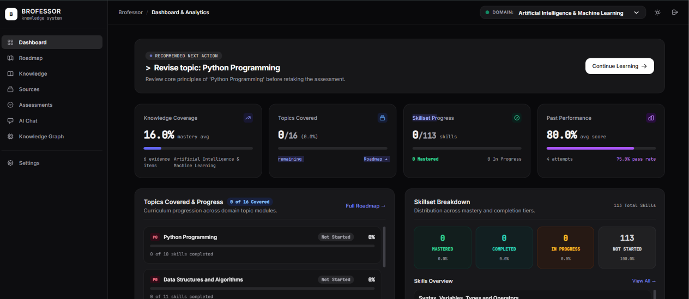
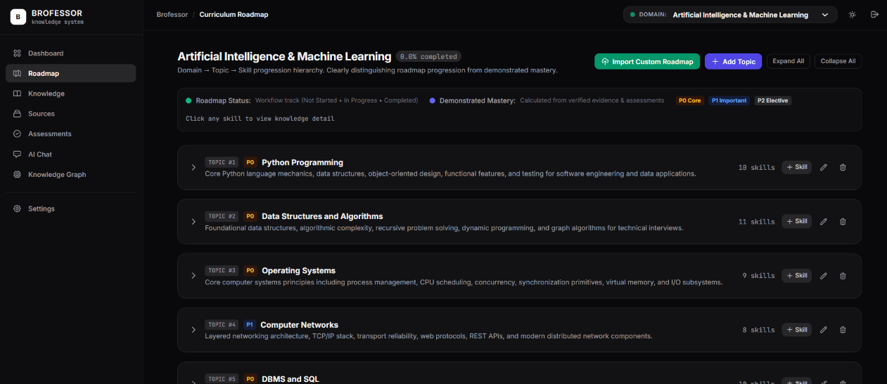
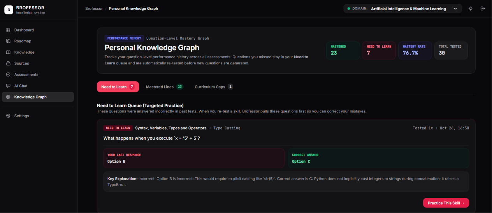
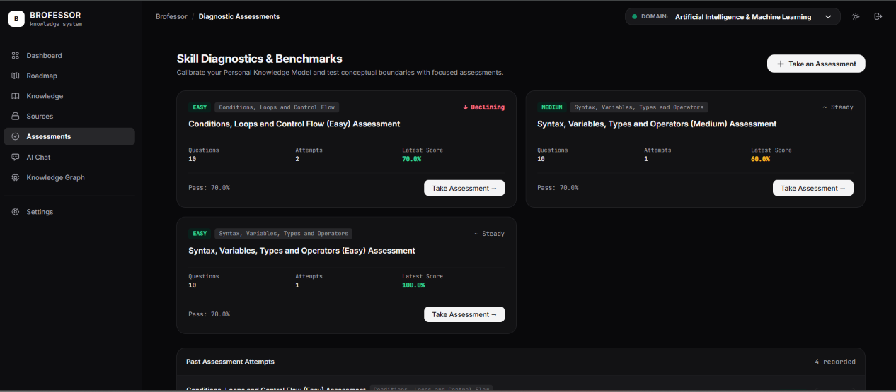
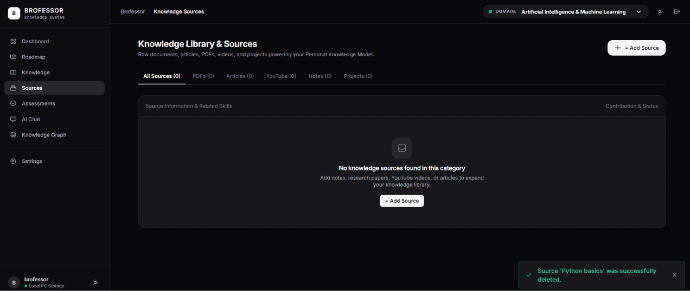
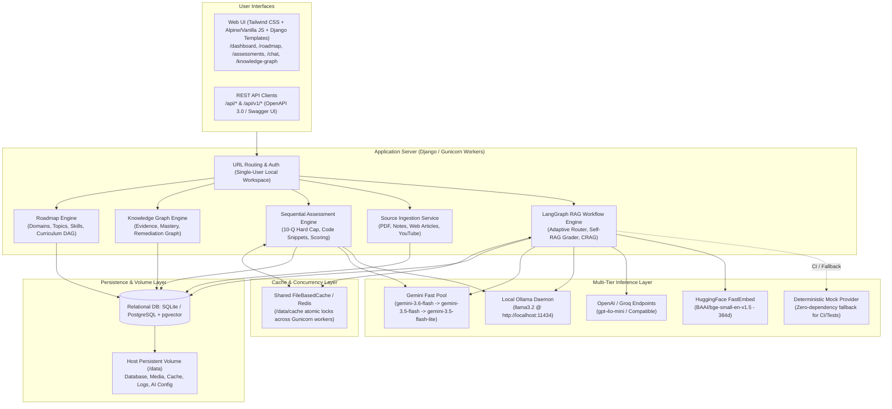
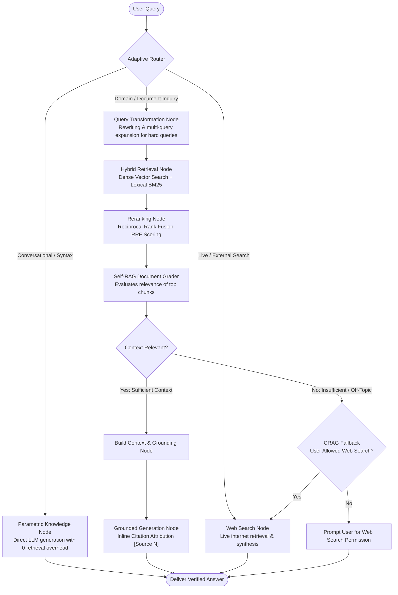
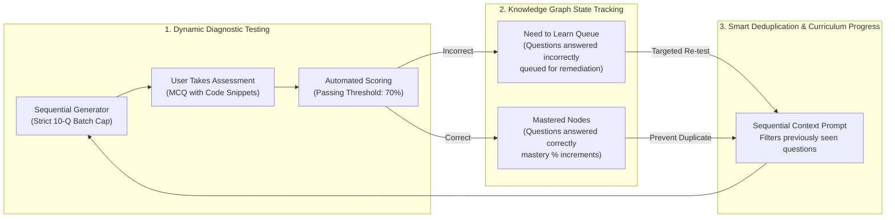
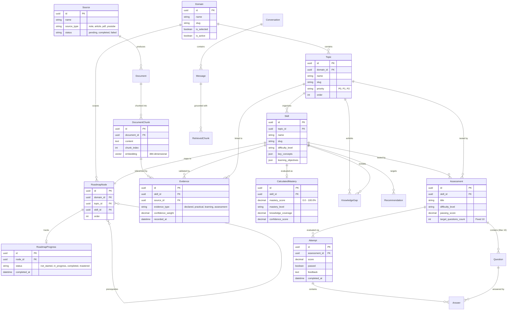

# Brofessor 🧠

> **Brofessor** is a production-ready, local-first Personal Knowledge System (PKS), adaptive learning engine, and advanced LangGraph RAG assistant. It transforms raw notes, documents, and web resources into structured curricula, tracks personal mastery, and conducts interactive assessments with complete data privacy.

[](https://hub.docker.com/r/nitins715/brofessor)
[](https://hub.docker.com/r/nitins715/brofessor)
[](https://github.com/Nitins715/Brofessor)
[](LICENSE)

---

## Table of Contents

- [Overview](#overview)
- [Key Features](#key-features)
- [Application Showcase](#-application-showcase)
- [System Architecture](#system-architecture)
  - [High-Level Architecture Diagram](#high-level-architecture-diagram)
- [Advanced LangGraph RAG Pipeline](#advanced-langgraph-rag-pipeline)
  - [RAG State Graph Workflow Diagram](#rag-state-graph-workflow-diagram)
- [Personal Knowledge Model & Knowledge Graph](#personal-knowledge-model--knowledge-graph)
  - [Knowledge Graph & Remediation Loop](#knowledge-graph--remediation-loop)
- [Database Architecture](#database-architecture)
  - [Entity Relationship (ER) Diagram](#entity-relationship-er-diagram)
- [Technology Stack](#technology-stack)
- [Project Directory Structure](#project-directory-structure)
- [Setup & Deployment](#setup--deployment)
  - [Option A: Public Docker Container (Instant Run — Recommended)](#option-a-public-docker-container-instant-run--recommended)
  - [Option B: Local Python Development Setup](#option-b-local-python-development-setup)
  - [Option C: Multi-Container Stack (Docker Compose)](#option-c-multi-container-stack-docker-compose)
- [Running Automated Tests](#running-automated-tests)
- [REST API Reference](#rest-api-reference)
- [Key Technical Decisions](#key-technical-decisions)
- [Troubleshooting & FAQ](#troubleshooting--faq)

---

## Overview

Brofessor acts as an intelligent academic mentor and study partner for software engineers, students, and researchers. Instead of treating study notes and documentation as passive bookmarks, Brofessor:

1. **Ingests Diverse Content**: Processes raw markdown notes, web articles, PDFs, and YouTube transcripts with intelligent deduplication.
2. **Adaptive Semantic Chunking & Embeddings**: Normalizes text into cohesive semantic chunks embedded locally via 384-dimensional `BAAI/bge-small-en-v1.5` or Ollama embeddings.
3. **Advanced LangGraph RAG (Adaptive, Self-RAG & CRAG)**: Routes questions adaptively between direct parametric knowledge, hybrid document retrieval (dense vector + lexical BM25), reciprocal rank fusion (RRF), self-evaluating document grading, and corrective web search fallback.
4. **Interactive Knowledge Graph & Mastery**: Visualizes learning progress dynamically. Correctly answered questions reinforce mastery nodes, while incorrect answers populate the "Need to Learn" queue for targeted remediation without repeating mastered questions.
5. **Contextual Question Generator**: Dynamically generates strictly capped 10-question diagnostic assessments with embedded code snippets, distractor explanations, and concept tags.

---

## Key Features

- **🚀 1-Command Public Docker Image**: Pre-packaged on Docker Hub (`nitins715/brofessor:latest`) with automated database migration, curriculum seeding, and static collection.
- **⚡ Resilient Multi-Model LLM Pool**:
  - **Cloud Primary (Gemini Fast Pool)**: Cycles seamlessly through `gemini-3.6-flash`, `gemini-3.5-flash`, and `gemini-3.5-flash-lite` with snappy 8-second timeouts and automatic failover.
  - **Local Privacy Fallback (Ollama)**: Automatically falls back to local models (`llama3.2`, `gemma3`) if no cloud API key is configured or when offline.
  - **OpenAI / Custom Compatible**: Full support for OpenAI (`gpt-4o-mini`), Groq, or OpenRouter endpoints.
- **🔄 Advanced LangGraph State Machine**: State-based RAG workflow featuring query transformation, adaptive query complexity classification, document grading, hallucination detection, and interactive web search permission.
- **📊 Adaptive Knowledge Graph**: Replaces static gap reports with an interactive knowledge graph tracking mastered concepts versus remediation items across all assessment attempts.
- **🛡️ Thread-Safe Distributed Caching**: Utilizes shared `/data/cache` file-based caching across multi-threaded Gunicorn worker processes, avoiding isolated memory lock collisions.

---

## 📸 Application Showcase

### 1. Dashboard & Learning Analytics
> Real-time tracking of knowledge coverage, active skillset breakdown, past test performance, and intelligent recommended next actions.



---

### 2. Interactive Curriculum Roadmap
> Hierarchical learning progression (`Domain → Topic → Skill`) with custom syllabus import, topic priority tiers (P0, P1, P2), and direct skill assessment launch.



---

### 3. Personal Knowledge Graph (Performance Memory)
> Question-level mastery graph tracking mastered concepts versus the "Need to Learn" remediation queue for targeted practice without repeating mastered questions.



---

### 4. Skill Diagnostics & Assessments
> Strict 10-question sequential diagnostics with automated LLM scoring, embedded code snippets, pass thresholds, and performance trends.



---

### 5. Multi-Modal Knowledge Library & Sources
> Centralized repository for ingesting and managing raw notes, PDFs, web articles, and video transcripts powering your local RAG index.



---

## System Architecture

Brofessor is designed around a decoupled, local-first architecture where the web interface, domain logic, state-graph RAG workflow, persistence layer, and inference engines interact seamlessly.

### High-Level Architecture Diagram



---

## Advanced LangGraph RAG Pipeline

Brofessor incorporates state-of-the-art RAG paradigms—including **Adaptive RAG**, **Modular RAG**, **Self-RAG**, and **Corrective RAG (CRAG)**—implemented as a compiled LangGraph state graph.

### RAG State Graph Workflow Diagram



### Pipeline Highlights:
1. **Adaptive Query Router**: Classifies incoming questions into `PARAMETRIC` (greeting/simple syntax), `RETRIEVAL` (local documents), or `WEB_SEARCH`. Straightforward queries bypass unnecessary rewriting to minimize latency.
2. **Hybrid Retrieval + Reciprocal Rank Fusion (RRF)**: Combines dense vector cosine similarities (384-dimensional embeddings) with lexical text matches, scoring results via RRF.
3. **Self-RAG Grader**: Inspects retrieved chunks before generation. If chunks are irrelevant, prevents hallucinated answers.
4. **Corrective RAG (CRAG)**: If the local knowledge base has insufficient evidence, Brofessor either queries external search or presents an interactive permission button: *"Search the Web for this Answer"*.
5. **Cloud Fast Pool with Instant Failover**: Cloud queries cycle sequentially through the fastest Gemini 3.x models (`gemini-3.6-flash`, `gemini-3.5-flash`, `gemini-3.5-flash-lite`) with an 8-second cutoff per model.

---

## Personal Knowledge Model & Knowledge Graph

Brofessor moves beyond static gap listings by generating an **interactive user Knowledge Graph**.

### Knowledge Graph & Remediation Loop



- **Mastery Queue**: Questions answered correctly establish verified evidence points, advancing the learner's skill mastery tier (`Beginner` $\to$ `Intermediate` $\to$ `Advanced` $\to$ `Expert`).
- **Need to Learn Queue**: Concepts or questions missed are flagged in the interactive Knowledge Graph. Subsequent diagnostic assessments prioritize these gaps while ensuring identical questions are not repeated once mastered.

---

## Database Architecture

The schema strictly separates raw ingested content from empirical evidence, calculated mastery records, and the curriculum hierarchy (`Domain → Topic → Skill → RoadmapNode`).

### Entity Relationship (ER) Diagram



---

## Technology Stack

| Layer | Component | Description |
|---|---|---|
| **Backend Framework** | Django 5.x & Django REST Framework | REST API design, modular app architecture, ORM |
| **RAG Orchestration** | LangGraph & LangChain Core | State-graph managing query transformation, hybrid retrieval, self-grading & CRAG |
| **Database** | SQLite3 (Single Container) / PostgreSQL 16 + pgvector | Relational schemas + 384-dimensional cosine vector indexing |
| **Caching & Concurrency** | Shared `FileBasedCache` / Redis | Multi-worker atomic lock synchronization on `/data/cache` |
| **AI LLM Inference** | Gemini Fast Pool (`gemini-3.6/3.5-flash`) / Ollama (`llama3.2`) / OpenAI | Multi-model failover with 8s cutoff, local Ollama fallback, and mock testing provider |
| **Embedding Engine** | Hugging Face FastEmbed (`BAAI/bge-small-en-v1.5`) | Fast, local 384-dimensional semantic text representations |
| **Web UI & Styling** | Tailwind CSS + Vanilla JS + Django Templates | Dark-mode dashboard, interactive roadmap, assessment runner, and chat |
| **API Documentation** | `drf-spectacular` | OpenAPI 3.0 specification (`schema.yml`) and Swagger / Redoc UI |
| **Containerization** | Docker & Docker Compose | Single-container image (`nitins715/brofessor:latest`) published on Docker Hub |

---

## Project Directory Structure

```text
Brofessor/
├── apps/
│   ├── accounts/             # User model and profile management
│   ├── assessments/          # Question generation, strict 10-Q capping, scoring, and attempts
│   ├── core/                 # Shared base models, logging, exceptions, responsive web views
│   ├── knowledge/            # Concepts, evidence items, calculated mastery, and Knowledge Graph
│   ├── mastery/              # Mastery calculation, evidence weights, and recommendations
│   ├── processing/           # Text extractors, semantic chunking, and embedding pipeline
│   ├── rag/                  # LangGraph workflow, Adaptive Router, Hybrid Retrieval, Web Search
│   │   ├── query_processing/ # Adaptive query classifier and query rewriting
│   │   ├── services/         # Hybrid retrieval, web search, conversation persistence
│   │   ├── workflow/         # LangGraph state machine, DocumentGrader, HallucinationChecker
│   │   └── llm/              # Gemini fast pool, Ollama, OpenAI, and Mock LLM providers
│   ├── roadmap/              # Domains, Topics, Skills, Roadmap Nodes, and DAG progress
│   └── sources/              # Multi-format source ingestion (PDF, text, web articles, YouTube)
├── config/
│   ├── settings.py           # Hardened Django settings with environment overrides & CSRF support
│   ├── urls.py               # Root URL configuration (/api/*, /api/v1/*, swagger, redoc)
│   └── wsgi.py
├── data/                     # Persistent local storage (DB, cache, media, logs) mapped to host
├── templates/                # Server-rendered templates
│   ├── layouts/              # Base layout, navbar, sidebar, theme tokens
│   └── pages/                # Dashboard, Roadmap, Knowledge Graph, Assessments, Chat, Settings
├── static/                   # Static CSS, JS, and font assets
├── Dockerfile                # Production single-container image definition
├── entrypoint.sh             # Startup migration, curriculum seeding, and Gunicorn launcher
├── docker-compose.yml        # Multi-container orchestration (postgres, redis, web, celery)
├── manage.py                 # Django management CLI
├── requirements.txt          # Python runtime dependencies
└── README.md                 # Complete system documentation
```

---

## Setup & Deployment

### Option A: Public Docker Container (Instant Run — Recommended)

Brofessor is published publicly on **Docker Hub**. Run the entire application locally with zero Python configuration:

```bash
# Pull the latest verified image
docker pull nitins715/brofessor:latest

# Run the container with persistent host storage
docker run -d \
  --name brofessor \
  -p 8000:8000 \
  -v brofessor_data:/data \
  nitins715/brofessor:latest
```

Open your browser to: **`http://localhost:8000/`**

- **Pre-Seeded Data**: Automatically migrates database schemas and seeds standard computer science curricula (AI & Machine Learning / Data Science).
- **Persistent Storage**: All notes, assessments, and AI configuration persist across container restarts inside the `brofessor_data` volume.
- **AI Configuration**: Navigate to the **Settings** tab in the web UI to enter your free Google Gemini API key or point to local Ollama (`http://host.docker.internal:11434`).

---

### Option B: Local Python Development Setup

#### Prerequisites
- **Python**: 3.11, 3.12, or 3.13
- **Ollama** (Optional for local offline LLM generation; Mock provider available for testing)

#### 1. Environment Setup
```powershell
# Windows PowerShell
python -m venv .venv
.\.venv\Scripts\Activate.ps1
python -m pip install --upgrade pip
pip install -r requirements.txt
```

```bash
# macOS / Linux
python3 -m venv .venv
source .venv/bin/activate
pip install --upgrade pip
pip install -r requirements.txt
```

#### 2. Configure Environment (`.env`)
```bash
cp .env.example .env
```
Key settings in `.env`:
```ini
DJANGO_SECRET_KEY=your-secure-secret-key
DJANGO_DEBUG=True
DJANGO_ALLOWED_HOSTS=localhost,127.0.0.1,0.0.0.0

# Database (defaults to SQLite in data/brofessor.sqlite3)
DB_ENGINE=sqlite
DATA_DIR=./data

# AI Provider Settings
LLM_PROVIDER=auto
GEMINI_API_KEY=your-gemini-api-key
GEMINI_MODEL=gemini-3.6-flash
OLLAMA_BASE_URL=http://127.0.0.1:11434
OLLAMA_MODEL=llama3.2
```

#### 3. Run Migrations & Seed Curricula
```bash
python manage.py migrate
python manage.py seed_domain_roadmaps
```

#### 4. Launch the Web Server
```bash
python manage.py runserver 127.0.0.1:8000
```
Open [http://127.0.0.1:8000/](http://127.0.0.1:8000/) in your browser.

---

### Option C: Multi-Container Stack (Docker Compose)

For scaling with dedicated PostgreSQL (`pgvector`) and Redis Celery workers:

```bash
docker compose up --build
```

---

## Running Automated Tests

Brofessor includes comprehensive test suites covering curriculum validation, roadmap DAG traversal, RAG query pipelines, and assessment capping:

```bash
# Run all tests (42/42 passing)
python manage.py test

# Run RAG & LangGraph workflow tests
python manage.py test apps.rag

# Run Assessment engine & sequential generator tests
python manage.py test apps.assessments

# Run web frontend & dashboard tests
python manage.py test apps.core
```

---

## REST API Reference

All endpoints are available under `/api/` and versioned `/api/v1/` routes. Interactive OpenAPI docs:
- **Swagger UI**: [http://127.0.0.1:8000/api/docs/](http://127.0.0.1:8000/api/docs/)
- **Redoc UI**: [http://127.0.0.1:8000/api/redoc/](http://127.0.0.1:8000/api/redoc/)
- **OpenAPI 3.0 Schema**: [http://127.0.0.1:8000/api/schema/](http://127.0.0.1:8000/api/schema/)

### Core API Endpoints

| Category | Method | Endpoint | Description |
|---|---|---|---|
| **RAG & Chat** | `POST` | `/api/v1/rag/chat/` | Execute end-to-end LangGraph RAG query with citation tracking |
| **Conversations** | `GET` / `POST` | `/api/v1/conversations/` | List or create conversation threads |
| **Sources** | `GET` / `POST` | `/api/sources/` | Ingest PDFs, notes, web articles, and YouTube transcripts |
| **Sources** | `DELETE` | `/api/sources/<id>/delete/` | Delete ingested knowledge source and cascade chunk vectors |
| **Roadmaps** | `GET` | `/api/roadmap/graph/<domain_id>/` | Retrieve complete directed learning roadmap graph |
| **Assessments** | `POST` | `/api/assessments/questions/generate/` | Generate 10-question assessment batch for a skill |
| **Assessments** | `POST` | `/api/assessments/attempts/<id>/submit/` | Submit answers for automatic LLM evaluation and scoring |
| **Knowledge Graph**| `GET` | `/api/knowledge/graph/` | Retrieve user performance graph (Mastered vs. Need to Learn) |
| **Mastery** | `GET` | `/api/mastery/skills/<skill_id>/` | View weighted mastery score and level (`Beginner` to `Expert`) |

---

## Key Technical Decisions

1. **Local-First with Zero-Friction Cloud Hybrid Fallback**:
   Student notes and assessment attempts remain strictly on the local workstation. When cloud reasoning is configured, Brofessor uses a pool of the newest low-latency models (`gemini-3.6-flash`, `gemini-3.5-flash`) with strict 8-second timeouts, falling back to local Ollama if offline.
2. **LangGraph State Machine for Deterministic RAG**:
   Instead of brittle linear chains, the RAG pipeline is orchestrated via a compiled LangGraph state graph. This enables conditional edge routing, query transformation, document relevance grading, and corrective search fallback with full transparency.
3. **Thread-Safe Shared Caching (`FileBasedCache`)**:
   To avoid multi-process race conditions in Gunicorn where in-memory caches cannot share assessment locks, Brofessor uses a unified `/data/cache` file-based cache ensuring atomic generation locks across all workers.
4. **Strict Assessment Batch Capping (10-Question Hard Cap)**:
   Assessment generation enforces strict database re-validation under atomic transactions. No assessment can ever generate or evaluate more than the target 10 questions, protecting learner score integrity.
5. **Interactive Knowledge Graph Over Static Gap Lists**:
   Learners retain full visibility over their mastery journey through a dynamic Knowledge Graph where correctly answered questions reinforce mastered nodes and incorrect answers feed directly into focused remediation queues.

---

## Troubleshooting & FAQ

#### 1. How do I configure my Gemini API Key?
Open Brofessor in your browser, click on **Settings** in the sidebar, paste your API key in the **Gemini API Key** field, and click **Save Settings**. Brofessor will automatically activate the fast cloud model pool.

#### 2. How do I connect to local Ollama running on my host machine?
If you are running Brofessor inside Docker and Ollama directly on your host machine:
- Set **Ollama Base URL** in Settings to: `http://host.docker.internal:11434`
- Make sure Ollama is serving requests: `ollama run llama3.2`

#### 3. How do I deploy Brofessor on a cloud server or custom domain?
Set the `DJANGO_ALLOWED_HOSTS` and `CSRF_TRUSTED_ORIGINS` environment variables to your domain:
```bash
docker run -d \
  -p 8000:8000 \
  -e DJANGO_ALLOWED_HOSTS="my-brofessor.up.railway.app,example.com" \
  -e CSRF_TRUSTED_ORIGINS="https://my-brofessor.up.railway.app,https://example.com" \
  -v brofessor_data:/data \
  nitins715/brofessor:latest
```

---

## License

This project is licensed under the [MIT License](LICENSE).
