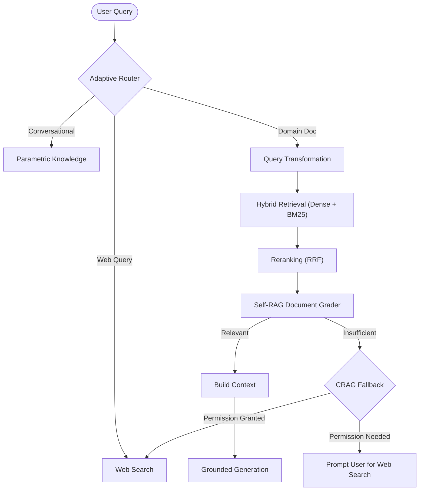
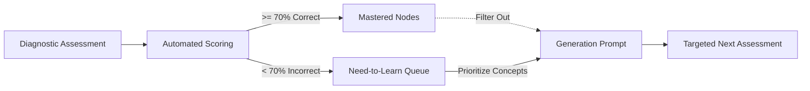
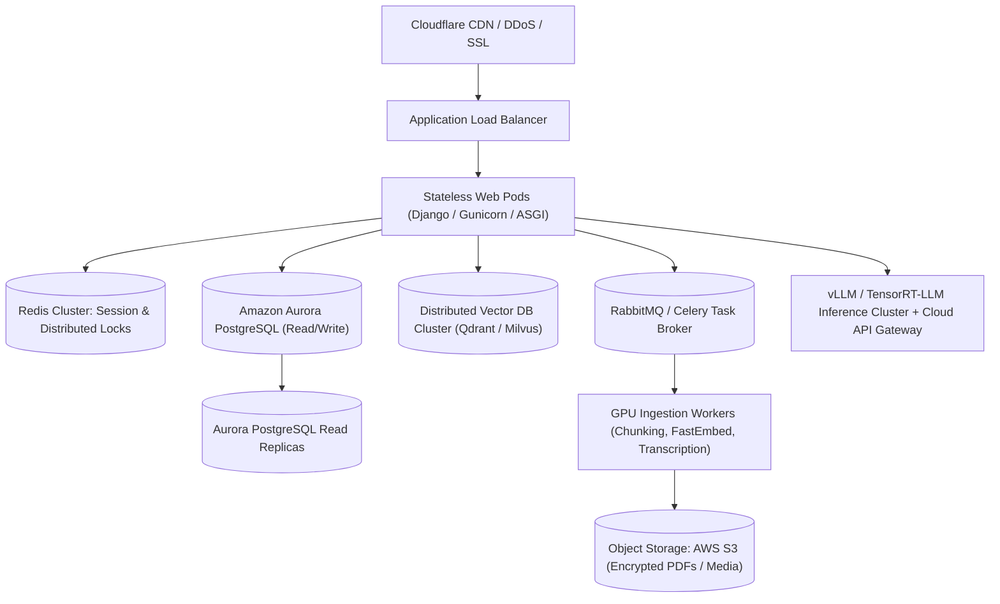

# Brofessor 🧠 — Top 35 Technical, Architectural & Design Interview Questions

This document compiles the **Top 35 technical, architectural, and system design interview questions** specifically tailored to **Brofessor**. It covers deep architectural decisions, trade-offs, edge-case engineering, RAG orchestration, multi-model resilience, database design, hierarchical chunking, knowledge graphs, Core Computer Science fundamentals (DBMS, OS, CN, OOPS), AI/ML career tracks, and production observability.

---

## Table of Contents

- [Category 1: System Architecture & Local-First Philosophy](#category-1-system-architecture--local-first-philosophy)
  - [1. Why choose a Local-First architecture over a multi-service cloud microservice setup?](#1-why-choose-a-local-first-architecture-over-a-multi-service-cloud-microservice-setup)
  - [2. How does Brofessor handle vector search across SQLite and PostgreSQL?](#2-how-does-brofessor-handle-vector-search-across-sqlite-and-postgresql)
  - [3. How is multi-process cache synchronization achieved without Redis?](#3-how-is-multi-process-cache-synchronization-achieved-without-redis)
- [Category 2: Advanced LangGraph RAG Engineering](#category-2-advanced-langgraph-rag-engineering)
  - [4. Why build RAG with a LangGraph state machine instead of linear chains?](#4-why-build-rag-with-a-langgraph-state-machine-instead-of-linear-chains)
  - [5. How does the Adaptive Query Router prevent parametric knowledge bypass?](#5-how-does-the-adaptive-query-router-prevent-parametric-knowledge-bypass)
  - [6. How does Corrective RAG (CRAG) with Human-in-the-Loop permission work?](#6-how-does-corrective-rag-crag-with-human-in-the-loop-permission-work)
  - [7. How are Document Grading and Hallucination Auditing optimized for latency?](#7-how-are-document-grading-and-hallucination-auditing-optimized-for-latency)
  - [8. What is the role of Query Transformation and Complexity Classification?](#8-what-is-the-role-of-query-transformation-and-complexity-classification)
- [Category 3: Retrieval, Embeddings & Reranking](#category-3-retrieval-embeddings--reranking)
  - [9. Why Hybrid Retrieval (Dense Vector + BM25) instead of pure vector search?](#9-why-hybrid-retrieval-dense-vector--bm25-instead-of-pure-vector-search)
  - [10. Why Reciprocal Rank Fusion (RRF) instead of linear score summation?](#10-why-reciprocal-rank-fusion-rrf-instead-of-linear-score-summation)
  - [11. Why use FastEmbed (`BAAI/bge-small-en-v1.5`) over cloud embedding APIs?](#11-why-use-fastembed-baaibge-small-en-v15-over-cloud-embedding-apis)
  - [12. How does `ContextBuilder` prevent token overflow and track provenance?](#12-how-does-contextbuilder-prevent-token-overflow-and-track-provenance)
- [Category 4: Multi-Model LLM Resilience & Fallback](#category-4-multi-model-llm-resilience--fallback)
  - [13. What is the architecture behind the Gemini Fast Model Pool with 8-second cutoffs?](#13-what-is-the-architecture-behind-the-gemini-fast-model-pool-with-8-second-cutoffs)
  - [14. How does the system achieve zero-network graceful degradation for CI and offline use?](#14-how-does-the-system-achieve-zero-network-graceful-degradation-for-ci-and-offline-use)
- [Category 5: Knowledge Model, Mastery Engine & Assessments](#category-5-knowledge-model-mastery-engine--assessments)
  - [15. How is Skill Mastery calculated using multi-factor evidence weighting?](#15-how-is-skill-mastery-calculated-using-multi-factor-evidence-weighting)
  - [16. How does the Knowledge Graph feed into the diagnostic remediation loop?](#16-how-does-the-knowledge-graph-feed-into-the-diagnostic-remediation-loop)
  - [17. How did you prevent race conditions from breaking the strict 10-Question assessment cap?](#17-how-did-you-prevent-race-conditions-from-breaking-the-strict-10-question-assessment-cap)
- [Category 6: Database Design, Real Production Bugs & Scalability](#category-6-database-design-real-production-bugs--scalability)
  - [18. Explain the relational schema separation between Sources, Documents, Chunks, and Evidence.](#18-explain-the-relational-schema-separation-between-sources-documents-chunks-and-evidence)
  - [19. Describe a subtle production bug you resolved in the RAG retrieval pipeline.](#19-describe-a-subtle-production-bug-you-resolved-in-the-rag-retrieval-pipeline)
  - [20. What is your architectural roadmap to scale Brofessor to 100,000 concurrent users?](#20-what-is-your-architectural-roadmap-to-scale-brofessor-to-100000-concurrent-users)
- [Category 7: Advanced RAG Innovations, GraphRAG & Production Observability](#category-7-advanced-rag-innovations-graphrag--production-observability)
  - [21. How does Hierarchical (Parent-Child) Chunking resolve the precision vs. context trade-off?](#21-how-does-hierarchical-parent-child-chunking-resolve-the-precision-vs-context-trade-off)
  - [22. How does the Entity-Relationship Knowledge Graph (GraphRAG) augment vector search?](#22-how-does-the-entity-relationship-knowledge-graph-graphrag-augment-vector-search)
  - [23. How is production RAG observability achieved via LangSmith, and how does the live ping check work?](#23-how-is-production-rag-observability-achieved-via-langsmith-and-how-does-the-live-ping-check-work)
  - [24. How does the system handle database duality (SQLite vs. PostgreSQL + pgvector) and what happens to embeddings between them?](#24-how-does-the-system-handle-database-duality-sqlite-vs-postgresql--pgvector-and-what-happens-to-embeddings-between-them)
  - [25. Why and how was the curriculum architecture refined into an auto-seeded, niche-first model?](#25-why-and-how-was-the-curriculum-architecture-refined-into-an-auto-seeded-niche-first-model)
- [Category 8: Core CS Fundamentals (DBMS, OS, CN, OOPS) & CodeKairo Ingestion](#category-8-core-cs-fundamentals-dbms-os-cn-oops--codekairo-ingestion)
  - [26. DBMS: Normalization (1NF–BCNF), ACID guarantees, WAL, and Concurrency Control (2PL vs. MVCC).](#26-dbms-normalization-1nf-bcnf-acid-guarantees-wal-and-concurrency-control-2pl-vs-mvcc)
  - [27. OS: Process vs. Thread scheduling, Deadlock conditions, and Virtual Memory Paging with TLB misses.](#27-os-process-vs-thread-scheduling-deadlock-conditions-and-virtual-memory-paging-with-tlb-misses)
  - [28. CN: TCP 3-Way Handshake, Flow/Congestion Control vs. UDP, DNS hierarchy, and TLS 1.3 handshake.](#28-cn-tcp-3-way-handshake-flowcongestion-control-vs-udp-dns-hierarchy-and-tls-13-handshake)
  - [29. OOPS: SOLID principles, Composition over Inheritance, Factory/Strategy patterns, and Abstract classes vs. Interfaces.](#29-oops-solid-principles-composition-over-inheritance-factorystrategy-patterns-and-abstract-classes-vs-interfaces)
- [Category 9: Modern AI Engineering Tracks (AI Engineer, Agentic AI, MLOps, Forward Deployed)](#category-9-modern-ai-engineering-tracks-ai-engineer-agentic-ai-mlops-forward-deployed)
  - [30. AI Engineer vs. Agentic AI Engineer: ReAct loops, tool execution boundaries, and multi-agent debate protocols.](#30-ai-engineer-vs-agentic-ai-engineer-react-loops-tool-execution-boundaries-and-multi-agent-debate-protocols)
  - [31. MLOps & Forward Deployed Engineering: Continuous evaluation, model drift, serving latency optimization (vLLM, NF4/INT8 quantization), and air-gapped constraints.](#31-mlops--forward-deployed-engineering-continuous-evaluation-model-drift-serving-latency-optimization-vllm-nf4int8-quantization-and-air-gapped-constraints)
- [Category 10: Brofessor Version 3 Platform Innovations](#category-10-brofessor-version-3-platform-innovations)
  - [32. How does Heading Stack Hierarchy Chunking eliminate context drift in dense retrieval?](#32-how-does-heading-stack-hierarchy-chunking-eliminate-context-drift-in-dense-retrieval)
  - [33. How does the Vis.js Hardware-Accelerated Concept Graph render dual-mode (DAG Flow vs. Physics) network topology for 400+ nodes and edges?](#33-how-does-the-visjs-hardware-accelerated-concept-graph-render-dual-mode-dag-flow-vs-physics-network-topology-for-400-nodes-and-edges)
  - [34. How does the Technical Interview Cheat Sheet Exporter dynamically compile multi-page ReportLab PDFs with `NumberedCanvas`?](#34-how-does-the-technical-interview-cheat-sheet-exporter-dynamically-compile-multi-page-reportlab-pdfs-with-numberedcanvas)
  - [35. How does the 1-Click Browser Bookmarklet capture web articles and bypass cross-origin browser sandbox restrictions?](#35-how-does-the-1-click-browser-bookmarklet-capture-web-articles-and-bypass-cross-origin-browser-sandbox-restrictions)

---

## Category 1: System Architecture & Local-First Philosophy

### 1. Why choose a Local-First architecture over a multi-service cloud microservice setup?

#### The Question
*"Why did you architect Brofessor as a single-container, local-first system rather than splitting it into cloud-native microservices (API gateway, auth service, vector microservice, worker pool)?"*

#### The Answer & Design Rationale
- **User Privacy & Data Ownership**: Brofessor acts as a personal mentor ingesting private notes, proprietary code repositories, internal PDFs, and academic records. A local-first design ensures sensitive proprietary documents never leave the user's workstation without explicit consent.
- **Zero-Friction Adoption & Cost**: Traditional RAG systems require hosted vector databases (Pinecone, Weaviate), cloud caches, and managed orchestration clusters. Brofessor packages everything into a 1-command Docker image (`docker run -p 8000:8000 -v ./data:/data nitins715/brofessor:latest`) with zero recurring operational cost.
- **Unified Storage Volume (`/data`)**: Database files, media uploads, downloaded ONNX embedding weights, runtime logs, and cache locks reside in a single mounted volume. Upgrading or rebuilding the container never results in data loss.
- **Dual-Mode Decoupling**: While optimized as a single container by default, Brofessor cleanly separates concerns into modular Django apps (`apps/rag`, `apps/processing`, `apps/knowledge`, `apps/assessments`). It supports a seamless switch to a full multi-container production stack via `docker-compose.yml` (`PostgreSQL + pgvector + Redis + Celery`) using the `--profile full-stack` flag.

---

### 2. How does Brofessor handle vector search across SQLite and PostgreSQL?

#### The Question
*"SQLite does not support pgvector or native HNSW vector indexes. How did you design the persistence and retrieval layer to run seamlessly on both engines without requiring separate codebases?"*

#### The Answer & Design Rationale
- **Abstract Retrieval Service (`RetrievalService.search`)**: The vector search logic checks the active database vendor via `django.db.connection.vendor`.
- **PostgreSQL Path**: Employs `pgvector.django.CosineDistance` within native ORM queries. The `DocumentChunk` model features an `HnswIndex` (`m=16, ef_construction=64, opclasses=['vector_cosine_ops']`), executing sub-millisecond approximate nearest neighbor (ANN) searches directly inside PostgreSQL.
- **SQLite Fallback Path**: In SQLite mode, embedding vectors (384 dimensions) are stored as JSON arrays in the `embedding` column. At search time, candidates are evaluated in Python memory:
  $$\text{Cosine Similarity} = \frac{\mathbf{u} \cdot \mathbf{v}}{\|\mathbf{u}\|_2 \|\mathbf{v}\|_2}$$
  $$\text{Distance} = 1.0 - \text{Similarity}$$
- **Performance Trade-Off**: For personal knowledge bases (< 50,000 chunks), computing cosine distance in Python takes < 15ms, completely eliminating the need for compiling C extensions like `sqlite-vss` on Windows/macOS/Linux. When scaling beyond 50k chunks, users switch to PostgreSQL by changing `DB_ENGINE=postgresql` in `.env`.

---

### 3. How is multi-process cache synchronization achieved without Redis?

#### The Question
*"Gunicorn uses multiple worker processes (`gthread`), each with separate memory address spaces. How do you prevent race conditions and duplicate assessment generation without requiring a Redis daemon?"*

#### The Answer & Design Rationale
- **The Problem with In-Memory Caching (`LocMemCache`)**: Under multiple Gunicorn worker processes, each worker maintains its own independent memory dictionary. If a student initiates an assessment generation request, Worker A might acquire a local lock, but Worker B knows nothing about it, causing concurrent LLM calls and duplicate question generation.
- **The Solution — Shared `FileBasedCache`**: Brofessor maps Django's default cache to `/data/cache` on the shared persistent volume:
  ```python
  CACHES = {
      "default": {
          "BACKEND": "django.core.cache.backends.filebased.FileBasedCache",
          "LOCATION": os.path.join(DATA_DIR, "cache"),
          "TIMEOUT": 300,
          "OPTIONS": {"MAX_ENTRIES": 1000},
      }
  }
  ```
- **Atomic File Locks**: Django's `FileBasedCache` utilizes OS-level atomic file locks (`flock` on POSIX, `LockFile` on Windows) during read/write operations. When a worker sets `cache.add(lock_key, True, timeout=60)`, the lock is atomically recognized across all Gunicorn processes, eliminating duplicate LLM invocations with zero external server dependencies.

---

## Category 2: Advanced LangGraph RAG Engineering

### 4. Why build RAG with a LangGraph state machine instead of linear chains?

#### The Question
*"Most production tutorials use sequential pipelines (`Prompt -> Retriever -> LLM`). Why did you adopt a compiled LangGraph state graph for Brofessor?"*



#### The Answer & Design Rationale
- **Failure Modes of Linear Chains**:
  1. *Unnecessary Retrieval*: Greetings ("hi") or basic arithmetic ("15 * 4") trigger expensive embedding and vector searches.
  2. *Hallucination on Irrelevant Context*: If retrieved chunks are off-topic, a linear chain forces the LLM to hallucinate or summarize garbage.
  3. *Inability to Recover*: Linear chains cannot loop back, rewrite queries, or branch into internet searches when local documents lack answers.
- **LangGraph Advantages in Brofessor**:
  - **Stateful Typed Contract (`RAGState`)**: Explicitly tracks `query`, `transformed_query`, `retrieved_chunks`, `reranked_chunks`, `graded_chunks`, `citations`, and `response_source`.
  - **Conditional Edges**: Dynamic routing based on query classification and grading evaluation (`route_decision_edge`, `grading_decision_edge`, `crag_decision_edge`).
  - **Cyclic Corrective Capability**: Enables Self-RAG and Corrective RAG (CRAG) patterns where the graph can self-assess retrieval quality before generating answers.

---

### 5. How does the Adaptive Query Router prevent parametric knowledge bypass?

#### The Question
*"In an early iteration, technical questions like 'What is REPL?' or 'Explain Python loops' bypassed internal documents and answered from parametric memory. How did you diagnose and solve this?"*

#### The Answer & Design Rationale
- **Root Cause Analysis**: The router's LLM system prompt initially instructed:
  `"PARAMETRIC: ... basic standard programming questions without needing local files (e.g. 'what does len() do in Python')"`.
  Consequently, LLMs classified common coding queries as `PARAMETRIC`, routing them away from stored documents and notes.
- **Two-Tier Hybrid Routing Architecture (`AdaptiveRouter.classify`)**:
  1. **Tier 1 — Zero-Latency Heuristic Gate (< 1ms)**:
     - Pure social greetings & pleasantries (`hi`, `hello`, `who are you`, `thanks`) $\to$ `PARAMETRIC`.
     - Arithmetic calculations (regex `^[\d\s\+\-\*\/\(\)\^\.]+$`) $\to$ `PARAMETRIC`.
     - Explicit web triggers (`search web`, `google it`) $\to$ `WEB_SEARCH`.
     - Technical domain keywords (`python`, `variable`, `repl`, `postgres`, `indexing`, `rag`, `pdf`, etc.) and inquiry patterns (`what is`, `how does`, `explain`) $\to$ **forced directly to `RETRIEVAL`**.
  2. **Tier 2 — LLM Fallback Classifier**:
     - Evaluates edge cases with a strict system prompt: *"When in doubt, ALWAYS choose RETRIEVAL so stored sources and documents are searched."*
- **Outcome**: Greetings answer instantly with 0ms database latency, while all technical inquiries reliably execute hybrid retrieval across ingested documents.

---

### 6. How does Corrective RAG (CRAG) with Human-in-the-Loop permission work?

#### The Question
*"How does your CRAG implementation balance automated internet search against user privacy and unexpected API latency?"*

#### The Answer & Design Rationale
- **The CRAG Problem**: Traditional Corrective RAG automatically dispatches web searches whenever local retrieval confidence is low. However, in a privacy-first personal assistant, silently sending queries to public search engines (DuckDuckGo, Google) can leak proprietary research or confidential notes.
- **The Interactive Permission Flow**:
  1. `DocumentGrader` evaluates retrieved document chunks against the user query.
  2. If all chunks are graded off-topic or insufficient, the graph routes to `crag_fallback_node`.
  3. Instead of executing an unconfirmed web search, Brofessor returns:
     ```text
     "I couldn't find sufficient information in your stored documents to answer this question accurately.
     Would you like me to search the web for '...'?"
     ```
  4. The response sets `response_source = "web_prompt"` and `can_search_web = True`.
  5. The UI dynamically renders an interactive **"Search Web"** action button. Clicking it re-invokes the RAG endpoint with `allow_web_search=true`, which transitions straight to `web_search_node` and provides grounded web citations.

---

### 7. How are Document Grading and Hallucination Auditing optimized for latency?

#### The Question
*"Running an LLM call to grade every retrieved chunk and another LLM call to check hallucinations can introduce 5–10 seconds of latency. How did you optimize this pipeline for sub-second responses?"*

#### The Answer & Design Rationale
- **Document Grading Optimizations (`DocumentGrader`)**:
  - **Complexity Bypass**: `QueryComplexityClassifier.is_hard(query)` checks if the question contains comparative reasoning (`vs`, `difference between`), multiple clauses, or multi-hop logic. Simple, direct queries bypass LLM grading entirely and fast-track top reranked chunks.
  - **Similarity Heuristic Window**:
    - If `chunk.similarity_score >= 0.40`: Automatically classified as relevant (skips LLM).
    - If `chunk.similarity_score < 0.15`: Automatically discarded (skips LLM).
    - Only borderline scores (0.15 to 0.39) undergo LLM grading if the query is hard.
- **Hallucination Checker Optimizations (`HallucinationChecker`)**:
  - **Fast Citation Audit**: If the generated response explicitly includes citation brackets (`[Source 1]`, `[Source 2]`) and shares a significant vocabulary intersection with the context (> 3 common keywords), it is immediately accepted as grounded without an LLM verification call.

---

### 8. What is the role of Query Transformation and Complexity Classification?

#### The Question
*"Why not rewrite every user query using an LLM before performing vector search?"*

#### The Answer & Design Rationale
- **The Pitfall of Blanket Query Rewriting**:
  1. *Latency Penalty*: Each query expansion step adds 500ms–2000ms.
  2. *Query Drift*: For crisp queries like *"What is REPL?"*, rewriting can introduce hallucinations or change concise search keywords into verbose prose that hurts BM25 lexical precision.
- **Selective Query Transformation (`QueryTransformer.transform`)**:
  - Controlled by `QueryComplexityClassifier`:
    ```python
    HARD_INTENT_PATTERNS = [
        r"\b(?:compare|comparison|versus|\bvs\b|difference between|tradeoffs?)\b",
        r"\b(?:how does .+ affect|relationship between|impact of .+ on)\b",
        r"\b(?:step by step|architecture of|detailed implementation|deep dive)\b",
    ]
    ```
  - Only queries matching multi-clause or comparative patterns undergo LLM transformation.
  - Strips conversational boilerplate (*"Can you please explain..."* $\to$ *"PostgreSQL HNSW vector index construction parameters"*), maximizing both dense and sparse retrieval precision.

---

## Category 3: Retrieval, Embeddings & Reranking

### 9. Why Hybrid Retrieval (Dense Vector + BM25) instead of pure vector search?

#### The Question
*"Dense embeddings are semantic. Why did you implement BM25 lexical scoring alongside dense vector search?"*

#### The Answer & Design Rationale
- **The Failure Modes of Dense-Only Search**:
  - Technical documents contain precise alphanumeric identifiers, function signatures (`get_system_ai_config()`), configuration flags (`--profile full-stack`), and mathematical equations.
  - General-purpose embedding models compress these into semantic concepts, often failing to rank exact keyword matches at rank #1.
- **The Brofessor Hybrid Retrieval Architecture (`HybridRetrievalService`)**:
  1. **Dense Retrieval Pool**: Fetches the top $2 \times K$ candidates via cosine vector distance.
  2. **Sparse Retrieval Pool (Custom `BM25Scorer`)**:
     - Custom tokenizer with camelCase splitting (`calculateFibonacci` $\to$ `calculate`, `Fibonacci`) and snake_case splitting (`user_id` $\to$ `user`, `id`).
     - Queries the entire document corpus using Django Q-filters (`Q(content__icontains=term)`) and scores candidate chunks via Okapi BM25 ($k_1=1.5, b=0.75$).
  3. **Reciprocal Rank Fusion**: Merges both candidate pools to ensure that exact symbol matches and broader semantic context are both captured.

---

### 10. Why Reciprocal Rank Fusion (RRF) instead of linear score summation?

#### The Question
*"Why combine dense and sparse results using Reciprocal Rank Fusion (RRF) rather than normalizing and adding the cosine score and BM25 score?"*

#### The Answer & Design Rationale
- **The Score Calibration Problem**:
  - Cosine similarity produces bounded values $[-1.0, 1.0]$ (typically $[0.0, 1.0]$ in text embeddings).
  - BM25 produces unbounded scores $[0, +\infty)$ dependent on document frequency, query length, and document length.
  - Normalizing BM25 using Min-Max scaling is brittle because a single outlier chunk with high term frequency distorts all scores across different queries.
- **The RRF Solution**:
  $$RRF\_Score(d) = \sum_{m \in M} \frac{w_m}{k + rank_m(d)}$$
  - Where $k = 60$ (standard constant in information retrieval), $w_{\text{dense}} = 0.7$, and $w_{\text{sparse}} = 0.3$.
  - RRF operates purely on **ordinal ranking positions**, making it completely immune to score distribution differences between dense embeddings and lexical algorithms.

---

### 11. Why use FastEmbed (`BAAI/bge-small-en-v1.5`) over cloud embedding APIs?

#### The Question
*"Why use a local ONNX embedding model rather than OpenAI's `text-embedding-3-small` or Google's Embedding API?"*

#### The Answer & Design Rationale
- **Zero API Costs & Offline Independence**: Ingesting textbooks or hundreds of PDFs generates tens of thousands of chunks. Using cloud APIs would cost money, require active internet connectivity, and risk hitting rate limits.
- **High-Performance ONNX Runtime**: `FastEmbed` runs `BAAI/bge-small-en-v1.5` on the CPU using optimized C++ ONNX runtimes. Generating embeddings takes ~20–30ms per batch without requiring an expensive NVIDIA GPU.
- **Dimensions vs. Quality**: At 384 dimensions, `bge-small-en-v1.5` outperforms older 1536d models (such as OpenAI `text-embedding-ada-002`) on the MTEB retrieval benchmark while using **$75\%$ less storage and memory** per vector index.

---

### 12. How does `ContextBuilder` prevent token overflow and track provenance?

#### The Question
*"How does `ContextBuilder` assemble the final context prompt, prevent LLM context window crashes, and pass citation metadata to the UI?"*

#### The Answer & Design Rationale
- **Content Deduplication**: Multiple chunks across different pages or slides often duplicate identical text (headers, disclaimers). `ContextBuilder` hashes chunk content to prevent redundant text from consuming token space.
- **Hard Character Guard (`RAG_MAX_CONTEXT_CHARS`)**: Enforces a strict budget (default: 4,000 characters ~ 1,000 tokens), cleanly truncating candidate blocks while preserving source metadata headers.
- **Structured Provenance Formatting**:
  ```text
  --- Source [1]: Python Handbook | Document: Variables & Data Types | Type: pdf | Page: 14 ---
  Python integers have arbitrary precision...
  ```
- **Serialization for Interactive Citations**: Outputs both the formatted context text for the LLM prompt and serialized `Citation` objects containing `chunk_id`, `rank`, `similarity_score`, `rerank_score`, `page`, `timestamp`, and `content`. This powers the frontend citation chips and collapsible preview cards.

---

## Category 4: Multi-Model LLM Resilience & Fallback

### 13. What is the architecture behind the Gemini Fast Model Pool with 8-second cutoffs?

#### The Question
*"Cloud LLM APIs periodically suffer from rate limits (HTTP 429), server overloads (HTTP 503), or network latency spikes. How does Brofessor handle this?"*

#### The Answer & Design Rationale
- **The Multi-Model Cloud Fast Pool (`GeminiLLMProvider`)**:
  Rather than binding statically to a single model, Brofessor configures a priority pool:
  1. `gemini-3.6-flash` (Primary reasoning)
  2. `gemini-3.5-flash` (First failover)
  3. `gemini-3.5-flash-lite` (Ultra-low latency second failover)
- **Strict 8-Second Circuit Breaker**:
  Each cloud HTTP request enforces a strict 8-second timeout (`timeout=8.0`). If a model times out, returns HTTP 429/503, or fails DNS resolution, the provider logs a warning and cascades immediately to the next candidate model in the pool.
- **User Experience**: The user experiences a transparent ~8s fallback transition rather than an indefinite browser hang or hard crash.

---

### 14. How does the system achieve zero-network graceful degradation for CI and offline use?

#### The Question
*"How do you run comprehensive automated test suites (68 tests) in CI/CD environments without internet access or running an Ollama daemon?"*

#### The Answer & Design Rationale
- **Provider Resolution Hierarchy (`get_llm_provider`)**:
  ```text
  Explicit override -> Cloud (Gemini / OpenAI) -> Local (Ollama) -> Deterministic Mock
  ```
- **The `MockLLMProvider`**:
  A zero-dependency mock provider implementing `BaseLLMProvider`. It accepts customizable canned responses (e.g. structured JSON routing decisions, assessment questions) and runs entirely in memory without opening socket connections.
- **Result**: `python manage.py test` executes all 68 unit and integration tests across RAG, hierarchical chunking, graph services, roadmap graph algorithms, assessments, and mastery calculations in **under 15 seconds** with zero external dependencies.

---

## Category 5: Knowledge Model, Mastery Engine & Assessments

### 15. How is Skill Mastery calculated using multi-factor evidence weighting?

#### The Question
*"Why avoid simple percentage averages (e.g. 8/10 = 80%) when calculating a learner's skill mastery?"*

#### The Answer & Design Rationale
- **The Problem with Raw Percentages**: A user might pass a quiz by guessing or cramming once, but that does not demonstrate sustained competence across theoretical understanding, reading depth, and practical diagnostics.
- **The Multi-Factor Mastery Formula (`MasteryCalculationService`)**:
  Brofessor combines four distinct evidence streams, each weighted by empirical confidence:
  1. **Assessment Evidence (Weight: 50%)**: Direct diagnostic test scores on sequential questions.
  2. **Practical Evidence (Weight: 25%)**: Projects, code implementations, or exercises completed.
  3. **Learning Evidence (Weight: 15%)**: Reading and digesting internal notes, PDFs, and documentation.
  4. **Declared Confidence (Weight: 10%)**: Self-assessed comfort level.
- **Mastery Tiers**: Maps continuous scores $[0.0, 100.0\%]$ to discrete proficiency tiers:
  - `0% - 29%`: Beginner
  - `30% - 59%`: Intermediate
  - `60% - 84%`: Advanced
  - `85% - 100%`: Expert

---

### 16. How does the Knowledge Graph feed into the diagnostic remediation loop?

#### The Question
*"How does Brofessor's interactive Knowledge Graph prevent learners from repeatedly testing concepts they have already mastered?"*



#### The Answer & Design Rationale
- **Bi-Directional Knowledge Graph State**:
  - Every assessment question answered correctly creates/updates a **Mastered Node**, incrementing the skill's verified coverage.
  - Every question answered incorrectly or timed out populates the **Need-to-Learn Queue**, attaching specific distractor feedback.
- **Remediation Loop**: When a user generates a follow-up assessment for that skill, Brofessor pulls the question signatures from the Mastered Nodes and passes them as negative constraints into the LLM prompt while explicitly prompting for questions on concepts in the Need-to-Learn queue.
- **Outcome**: The student never sees repetitive questions for concepts they understand; tests focus exclusively on remaining knowledge gaps.

---

### 17. How did you prevent race conditions from breaking the strict 10-Question assessment cap?

#### The Question
*"In an early version, rapid duplicate submissions or parallel workers could generate 11 or 12 questions for a 10-question assessment. How did you implement a bulletproof hard cap?"*

#### The Answer & Design Rationale
- **Multi-Layer Defensive Synchronization**:
  1. **Distributed Cache Lock**: Before calling the LLM batch generator, the worker acquires an atomic lock:
     `cache.add(f"generating_assessment_{assessment_id}", True, timeout=60)`.
     If the key exists, subsequent requests yield and poll until generation completes.
  2. **Database Atomic Transaction (`transaction.atomic`)**:
     Inside the persistence block, the code queries the database under a fresh lock:
     ```python
     with transaction.atomic():
         existing_count = Question.objects.filter(assessment=assessment).count()
         remaining_slots = max(0, 10 - existing_count)
         if remaining_slots == 0:
             return existing_questions
         # Hard slice batch output
         valid_new_questions = generated_batch[:remaining_slots]
         Question.objects.bulk_create(valid_new_questions)
     ```
  3. **Database Unique Constraints**: Unique constraints on `(assessment, order)` prevent duplicate ordering slots.

---

## Category 6: Database Design, Real Production Bugs & Scalability

### 18. Explain the relational schema separation between Sources, Documents, Chunks, and Evidence.

#### The Question
*"Why decouple raw ingested content across four separate relational tables (`Source -> Document -> DocumentChunk -> Evidence`) instead of storing everything in one flat table?"*

#### The Answer & Design Rationale
- **`Source` (Provenance Entity)**: Tracks the physical origin (e.g. URL, PDF file path, YouTube link, status, ingestion error messages). Multiple documents can derive from a single multi-file repository or batch archive.
- **`Document` (Normalized Content Entity)**: Stores extracted clean markdown and a `content_hash` (SHA-256). When a source is re-synced, Brofessor compares the content hash; if unchanged, it skips expensive re-chunking and re-embedding.
- **`DocumentChunk` (Retrieval Unit)**: Holds the semantically chunked text, token count, positional chunk index, and high-dimensional vector embedding.
- **`Evidence` (Knowledge Mapping Entity)**: A many-to-many relationship linking specific chunks to curriculum `Skills` and `Topics` with empirical confidence weights.
- **Benefit**: If a curriculum is reorganized or new skills are added, the underlying chunk embeddings do not need to be recomputed; only the lightweight `Evidence` junction records are updated.

---

### 19. Describe a subtle production bug you resolved in the RAG retrieval pipeline.

#### The Question
*"Can you give an example of a difficult production bug you uncovered in the RAG pipeline and how you debugged it?"*

#### The Answer & Design Rationale
- **The Bug**: In `apps/rag/workflow/graph.py`, after `document_grading_node` filtered the candidates, `build_context_node` crashed or generated empty citation snippets in the frontend chat interface.
- **Root Cause Investigation**:
  - `reranking_node` produced a list of `RerankResult` instances (which wrap `SearchResult` and include `rerank_score`, `new_rank`, etc.).
  - `document_grading_node` unwrapped these into a raw list of `SearchResult` objects:
    `candidate_search_results = [r.search_result for r in reranked]`.
  - When `ContextBuilder.build()` iterated over the items, it checked `hasattr(item, "search_result")`. Because they had been stripped down to `SearchResult`, the final `Citation` objects lost their computed RRF scores and original ranks.
  - Furthermore, `Citation` objects lacked the raw `content` attribute, passing only a 150-character `snippet` to the frontend, which caused the UI's collapsible chunk inspection card to render blank text.
- **The Fix**:
  1. Updated `document_grading_node` to filter and retain the original `RerankResult` wrapper objects.
  2. Enhanced `ContextBuilder.build()` to pass full `content` alongside `snippet` in `Citation` and `CitationSerializer`.
  3. Added an explicit unit test `test_grounded_document_pipeline_with_citations_and_content` to verify that citations, scores, and chunk text persist end-to-end.

---

### 20. What is your architectural roadmap to scale Brofessor to 100,000 concurrent users?

#### The Question
*"Brofessor works as a local-first system. If you were funded to launch Brofessor as a SaaS platform serving 100,000 active students, how would you redesign the architecture?"*

#### The Answer & Design Rationale



1. **Stateless Web Application Tier**:
   - Containerize Django within Kubernetes (EKS / GKE) with Horizontal Pod Autoscaling (HPA) based on CPU/Request count.
   - Offload static assets to a Global CDN (Cloudflare).
2. **Database & Storage Scaling**:
   - Transition SQLite to **Amazon Aurora PostgreSQL** with read replicas for curriculum queries.
   - Enforce **Row-Level Security (RLS)** or workspace tenant isolation so users only query their own notes and roadmaps.
   - Store user PDFs and media files in encrypted object storage (AWS S3) rather than local disk.
3. **Dedicated Vector Retrieval Infrastructure**:
   - Migrate in-process vector storage to a dedicated distributed vector cluster (e.g. **Qdrant** or **Milvus**) with horizontal sharding and HNSW index caching in RAM.
4. **Asynchronous Ingestion Pipeline**:
   - Offload PDF parsing, YouTube transcription, and semantic chunking to asynchronous Celery worker pools managed via RabbitMQ.
5. **Private LLM Inference Cluster**:
   - Deploy **vLLM** or **TensorRT-LLM** on Kubernetes with GPU nodes (NVIDIA A10G/L4), utilizing PagedAttention and continuous batching to serve open-source models (`llama-3.3-70b`, `qwen-2.5-coder`) with sub-200ms time-to-first-token.

---

## Category 7: Advanced RAG Innovations, GraphRAG & Production Observability

### 21. How does Hierarchical (Parent-Child) Chunking resolve the precision vs. context trade-off?

#### The Question
*"In traditional RAG, you face a dilemma: small chunks (~200 tokens) yield high semantic vector similarity but lack sufficient context for LLM generation, while large chunks (~1000 tokens) dilute embedding representations. How did you architect the chunking pipeline to resolve this?"*

#### The Answer & Design Rationale
- **The Core Trade-off in Chunk Sizing**:
  - *Small Chunks*: Embedding vectors capture precise semantic nuances, but the LLM receives fragmented sentences missing section headers, prerequisites, or broader narrative context.
  - *Large Chunks*: Include complete paragraphs, but the vector is averaged across diverse topics, degrading cosine similarity ranking for specific technical questions.
- **Hierarchical (Parent-Child / Small-to-Big) Architecture**:
  1. **Schema Extension (`DocumentChunk`)**:
     - `chunk_level`: Distinguishes between `parent` (large section, ~1000 tokens) and `child` (sub-chunk, ~200 tokens).
     - `parent_chunk`: Self-referential foreign key linking child sub-chunks to their enclosing parent chunk.
  2. **Ingestion Splitting (`TextChunker`)**:
     - Documents are first segmented into cohesive parent sections (e.g. Markdown headers `##`, thematic boundaries).
     - Each parent section is recursively subdivided into overlapping child sub-chunks with exact positional tracking.
  3. **Small-to-Big Retrieval Workflow**:
     - Dense vector embedding (`BAAI/bge-small-en-v1.5`) indexes the **child chunks** for pinpoint similarity matching.
     - At retrieval time, when a child chunk passes similarity and RRF thresholds, the retriever resolves its `parent_chunk`.
     - The parent chunk's full contextual body is assembled into `ContextBuilder` for LLM prompt synthesis, deduplicating sibling chunks that share the same parent.
- **Outcome**: Achieves the search precision of small chunks with the rich explanatory context of large documents, completely eliminating context truncation errors.

---

### 22. How does the Entity-Relationship Knowledge Graph (GraphRAG) augment vector search?

#### The Question
*"Vector search excels at semantic similarity but struggles with multi-hop reasoning (e.g. 'How does Concept A connect to Concept C through Concept B?'). How did you design the Knowledge Graph extraction service?"*

#### The Answer & Design Rationale
- **Limitations of Pure Vector Retrieval**:
  - Vector similarity cannot follow relational links across disparate documents (e.g., an article explaining "Backpropagation" and a textbook chapter discussing "Automatic Differentiation" in PyTorch).
- **GraphRAG Entity-Relationship Extraction (`GraphService`)**:
  1. **Relational Models (`apps/sources/models.py`)**:
     - `Entity`: Identifies named concepts, libraries, algorithms, and techniques (e.g. `Transformer`, `RoPE`, `HNSW`, `FastEmbed`).
     - `Relationship`: Directed weighted edges with typed connections (`prerequisite_of`, `part_of`, `optimizes`, `variant_of`).
     - `EntityChunkMapping`: Connects entities to specific `DocumentChunk` records where they appear.
  2. **Automated Extraction During Ingestion**:
     - As documents are processed, the ingestion pipeline invokes `GraphService.extract_entities_and_relationships()` via an LLM prompt (or heuristic grammar extractor fallback).
     - Entities and relational triples are persisted directly to the relational database.
  3. **Multi-Hop Traversal at Query Time**:
     - When a complex query arrives, Brofessor identifies recognized entities, traverses adjacent graph nodes (1-hop and 2-hop neighbors), and joins chunks associated with those related concepts into the retrieval pool.
- **Outcome**: The assistant synthesizes answers that integrate interconnected concepts across different files, even if those files use different terminology.

---

### 23. How is production RAG observability achieved via LangSmith, and how does the live ping check work?

#### The Question
*"How do you track RAG latency, token expenditure, and retrieval faithfulness without burdening local users, and how did you implement the zero-friction connectivity verification?"*

#### The Answer & Design Rationale
- **LangSmith Tracing Integration**:
  - Brofessor integrates native LangChain/LangSmith tracing environment variables (`LANGSMITH_API_KEY`, `LANGCHAIN_API_KEY`, `LANGSMITH_PROJECT`, `LANGSMITH_TRACING`).
  - When enabled, every step of the LangGraph state graph—query classification, hybrid retrieval scoring, document grading, context formatting, and LLM token streaming—is streamed asynchronously to LangSmith.
  - Enables tracking of RAG triad benchmarks: **Faithfulness** (hallucination audit), **Answer Relevance**, and **Context Precision**.
- **Consolidated Settings Console (Single Source of Truth)**:
  - Repetitive indicators were removed from the sidebar and chat header, consolidating configuration solely into `templates/pages/settings.html`.
- **Real-Time Live Network Ping (`/api/v1/rag/integrations/verify/`)**:
  - The Settings page features a **"Ping Network Check"** button.
  - When clicked, the backend issues asynchronous lightweight health probes:
    - *LangSmith*: Queries `https://api.smith.langchain.com/info` with the provided API key, measuring round-trip latency in milliseconds.
    - *Gemini*: Issues a minimal probe to Google Generative Language API, checking API key validity and model availability.
    - *Ollama*: Probes the local daemon at `http://host.docker.internal:11434/api/tags`.
  - The UI updates status badges with real-time green/red indicator dots and displays round-trip ping time directly on screen.

---

### 24. How does the system handle database duality (SQLite vs. PostgreSQL + pgvector) and what happens to embeddings between them?

#### The Question
*"If a user generates embeddings on SQLite and then switches their deployment to PostgreSQL, what happens to the vector data, and why are embeddings kept 100% local?"*

#### The Answer & Design Rationale
- **Database Duality Architecture**:
  - *Single Docker Container*: Defaults to zero-config SQLite (`/data/brofessor.sqlite3`), enabling 1-click execution without running a secondary database container.
  - *Docker Compose Stack*: Enables PostgreSQL 16 with native `pgvector` and HNSW indexing for high-scale enterprise deployment.
- **The Embedding Separation & Local FastEmbed Model**:
  - Embeddings are **never** generated via the Gemini API key; they are generated **100% locally** using `FastEmbed (BAAI/bge-small-en-v1.5, 384d)`.
  - *Why*: This ensures vectors are identical in dimensionality and mathematical cosine space regardless of whether Gemini, Ollama, or OpenAI is selected as the LLM provider, eliminating API costs and rate limits.
- **What Happens When Switching Databases**:
  - SQLite and PostgreSQL are separate storage engines. If a user uploads PDFs on SQLite, chunks and vectors are stored in `brofessor.sqlite3`.
  - Switching `DB_ENGINE=postgresql` points Django to an independent PostgreSQL instance (`brofessor_db`). Chat queries in PostgreSQL will not find SQLite chunks unless transferred.
  - Brofessor supports clean transfer via standard Django serialization:
    ```bash
    python manage.py dumpdata sources --indent 2 > sources_backup.json
    # Switch DB_ENGINE=postgresql
    python manage.py loaddata sources_backup.json
    ```

---

### 25. Why and how was the curriculum architecture refined into an auto-seeded, niche-first model?

#### The Question
*"In earlier builds, users had to choose between incomplete placeholder roadmaps (like Data Science) and manually click a 'Re-seed Standard Roadmap' button in Settings. Why did you refactor this into an automatic niche-first curriculum?"*

#### The Answer & Design Rationale
- **The UX Anti-Pattern of Partial Roadmaps & Manual Seeding**:
  - Showing multiple domains where only one had complete topic DAGs and diagnostic questions led to a disjointed user experience.
  - Requiring a manual "Re-seed" button in Settings placed an unnecessary administrative burden on end learners.
- **The Niche-First Strategy**:
  - Scoped the core curriculum exclusively to **"Artificial Intelligence & Machine Learning"**, providing complete end-to-end coverage across 16 foundational and advanced topics (Deep Learning, Transformers, RAG, Optimization, Computer Vision, MLOps) with 113 skills.
  - Deactivated unconfigured domains so the top navigation bar displays a clean, focused roadmap with zero dropdown noise.
- **Automated Zero-Config Seeding**:
  - Replaced the manual UI button with Django's `post_migrate` signal in `apps/roadmap/apps.py`:
    ```python
    @receiver(post_migrate)
    def auto_seed_default_roadmap(sender, **kwargs):
        if not Domain.objects.filter(slug="artificial-intelligence-machine-learning").exists():
            call_command("seed_roadmap")
            call_command("seed_domain_roadmaps")
    ```
  - Added a runtime fallback in `active_domain_context` context processor.
- **Outcome**: The moment a user launches the Docker image, the database migrates and seeds the comprehensive AI/ML roadmap automatically. The learner lands directly on an active, curated curriculum with zero friction.

---

## Category 8: Core CS Fundamentals (DBMS, OS, CN, OOPS) & CodeKairo Ingestion

### 26. DBMS: Normalization (1NF–BCNF), ACID guarantees, WAL, and Concurrency Control (2PL vs. MVCC).

#### The Question
*"How does a production database balance high-throughput transactional writes with ACID consistency, and why did you choose Write-Ahead Logging (WAL) and MVCC paradigms when designing Brofessor's persistence layer?"*

#### The Answer & Design Rationale
- **Relational Normalization Ladder**:
  - **1NF**: Atomic values per column, no repeating groups.
  - **2NF**: In 1NF + no partial functional dependencies (every non-prime attribute is fully functionally dependent on the entire primary key).
  - **3NF**: In 2NF + no transitive dependencies ($X \to Y$ and $Y \to Z$ where $Z$ is non-prime).
  - **BCNF**: Strict 3NF variant where for every functional dependency $X \to Y$, $X$ must be a super key.
- **ACID Guarantees**:
  - **Atomicity**: All operations in a transaction succeed or all roll back (guaranteed via undo logs / shadow paging).
  - **Consistency**: Invariants and schema constraints (foreign keys, uniqueness) hold true before and after transaction commits.
  - **Isolation**: Concurrent transactions execute without cross-contamination (Read Uncommitted $\to$ Read Committed $\to$ Repeatable Read $\to$ Serializable).
  - **Durability**: Committed data survives system crashes, power loss, or restarts.
- **Write-Ahead Logging (WAL)**:
  - Changes are recorded sequentially in an append-only WAL buffer on disk *before* the dirty pages are flushed to database tables.
  - On crash restart, recovery executes ARIES: Analysis pass $\to$ Redo pass (repeating history) $\to$ Undo pass (rolling back uncommitted transactions).
- **Concurrency Control: Two-Phase Locking (2PL) vs. Multi-Version Concurrency Control (MVCC)**:
  - *Strict 2PL*: Growing phase (acquire locks) and Shrinking phase (release locks at commit). Causes severe contention: "Readers block Writers, Writers block Readers."
  - *MVCC (used in PostgreSQL & SQLite WAL)*: Readers never block Writers, and Writers never block Readers. Each update creates a new immutable tuple version with transaction IDs (`xmin`, `xmax`). Queries read a consistent snapshot of the database at their start timestamp. Dead tuples are cleaned asynchronously via `VACUUM`.

---

### 27. OS: Process vs. Thread scheduling, Deadlock conditions, and Virtual Memory Paging with TLB misses.

#### The Question
*"How does the Operating System manage concurrency, memory virtualization, and deadlock hazards, and how do these principles apply to Brofessor's multi-process Gunicorn architecture?"*

#### The Answer & Design Rationale
- **Process vs. Thread Architecture**:
  - **Process**: Independent execution unit with its own private virtual address space (code, data, heap, stack), file descriptors, and OS credentials. Protection boundary is enforced by hardware MMU. Context switches require invalidating or tagging the Translation Lookaside Buffer (TLB), incurring 1–5µs overhead.
  - **Thread**: Light-weight unit within a process sharing the same virtual address space, heap, and open sockets, but maintaining a private program counter, registers, and stack. Switching between threads of the same process preserves TLB state, reducing latency to ~100ns.
- **Deadlock Hazards & Coffman Conditions**:
  A deadlock occurs if and only if all 4 Coffman conditions hold simultaneously:
  1. *Mutual Exclusion*: Resources cannot be shared simultaneously.
  2. *Hold and Wait*: A process holds one resource while waiting for another.
  3. *No Preemption*: Resources cannot be forcibly revoked before task completion.
  4. *Circular Wait*: A closed chain of processes exists where each waits for a resource held by the next ($P_1 \to P_2 \dots \to P_1$).
  - *Mitigation*: Resource ordering hierarchy (impose global acquisition order), timeout locks with exponential backoff, or banker's algorithm.
- **Virtual Memory Paging & TLB**:
  - Address translation: CPU emits Virtual Addresses $(p, d)$. The hardware MMU traverses multi-level page tables to find the Physical Frame Number $(f, d)$.
  - **Translation Lookaside Buffer (TLB)**: High-speed associative cache on the CPU die storing recent virtual-to-physical frame mappings.
  - *TLB Miss Flow*: MMU experiences a cache miss $\to$ initiates a page table walk in DRAM $\to$ if valid page table entry, loads into TLB; if invalid, triggers a Page Fault interrupt (vector 14) $\to$ OS kernel loads page from disk swap into RAM.
  - *Page Replacement*: Least Recently Used (LRU) or Clock Algorithm (Second Chance via reference bits) evicts frames when physical RAM is exhausted.

---

### 28. CN: TCP 3-Way Handshake, Flow/Congestion Control vs. UDP, DNS hierarchy, and TLS 1.3 handshake.

#### The Question
*"How does network transport ensure reliability and cryptographic secrecy across unreliable internet hops, and how does Brofessor's client-server architecture leverage these guarantees?"*

#### The Answer & Design Rationale
- **TCP 3-Way Handshake**:
  1. **Client $\to$ Server (SYN)**: Sends initial sequence number $ISN_c$, options (MSS, Window Scale, SACK-Permitted).
  2. **Server $\to$ Client (SYN-ACK)**: Sends server sequence number $ISN_s$, acknowledges client sequence number $ACK = ISN_c + 1$.
  3. **Client $\to$ Server (ACK)**: Acknowledges server sequence number $ACK = ISN_s + 1$. Connection is now ESTABLISHED.
- **Connection Teardown (4-Way Handshake)**:
  - Client sends `FIN` $\to$ Server responds with `ACK` (half-close).
  - Server sends `FIN` $\to$ Client responds with `ACK` and enters `TIME_WAIT` (typically $2 \times MSL = 60\text{–}120\text{s}$) to absorb delayed duplicate segments.
- **Flow Control vs. Congestion Control**:
  - **Flow Control (End-to-End)**: Prevents sender from overwhelming receiver's buffer via Sliding Window Advertised Window ($rwnd$).
  - **Congestion Control (Network-Wide)**: Prevents sender from overwhelming intermediate routers ($cwnd$).
    - *Slow Start*: Exponential increase ($cwnd \leftarrow cwnd + 1$ per ACK) until slow-start threshold ($ssthresh$).
    - *Congestion Avoidance*: Linear increase ($cwnd \leftarrow cwnd + 1/cwnd$ per ACK).
    - *Fast Retransmit & Recovery*: 3 duplicate ACKs trigger immediate retransmission of missing packet without waiting for retransmission timer (RTO).
- **DNS Recursive Resolution Hierarchy**:
  - Client $\to$ Local Recursive Resolver (ISP/Cloudflare 1.1.1.1) $\to$ Root Nameserver (`.`) $\to$ TLD Nameserver (`.com`) $\to$ Authoritative Nameserver (`brofessor.ai`) $\to$ A/AAAA record returned and cached with TTL.
- **TLS 1.3 Cryptographic Handshake (1-RTT & 0-RTT)**:
  - TLS 1.2 required 2 round trips. TLS 1.3 combines key exchange into the `ClientHello`:
    1. *ClientHello*: Supported cipher suites + ephemeral Diffie-Hellman key shares ($g^a$).
    2. *ServerHello*: Chosen cipher suite + server key share ($g^b$) + encrypted certificate + Finished HMAC. Both derive symmetric session keys ($g^{ab}$).
    3. *0-RTT Resumption (Early Data)*: Re-connecting clients can send encrypted application payloads on the very first flight using pre-shared keys (PSK), at the cost of potential replay vulnerability.

---

### 29. OOPS: SOLID principles, Composition over Inheritance, Factory/Strategy patterns, and Abstract classes vs. Interfaces.

#### The Question
*"How are Object-Oriented design principles and software engineering patterns applied in Brofessor's modular codebase to prevent rigid coupling and high maintenance overhead?"*

#### The Answer & Design Rationale
- **The SOLID Principles in Brofessor**:
  - **S - Single Responsibility Principle**: `TextExtractor`, `MarkdownTextChunker`, and `FastEmbedClient` each possess exactly one reason to change.
  - **O - Open/Closed Principle**: The `BaseExtractor` defines an extensible interface. Adding support for Word docs (`DocxExtractor`) requires adding a new class without modifying existing PDF or text parsing logic.
  - **L - Liskov Substitution Principle**: Any subclass of `BaseLLMProvider` (`GeminiProvider`, `OllamaProvider`, `OpenAIProvider`) can be substituted in `LangGraphRAGService` without altering graph state contracts.
  - **I - Interface Segregation Principle**: Fine-grained view mixins and service interfaces ensure consumers only depend on methods they actually call.
  - **D - Dependency Inversion Principle**: High-level workflow nodes depend on abstractions (`RetrievalProtocol`), while concrete engines (`PgVectorEngine`, `SQLiteEngine`) implement the contract.
- **Composition over Inheritance**:
  - Deep inheritance hierarchies cause fragile base class dilemmas. Brofessor uses composition: `IngestionPipeline` *has-a* chunker, *has-a* cleaner, and *has-a* embedding model rather than inheriting from a monolithic pipeline base class.
- **Factory & Strategy Patterns**:
  - *Strategy Pattern*: `RerankingStrategy` encapsulates multiple interchangeable algorithms (`ReciprocalRankFusion`, `CrossEncoderReranker`). The caller chooses the strategy at runtime without conditional spaghetti.
  - *Factory Pattern*: `LLMProviderFactory.get_provider()` dynamically instantiates the correct model provider based on user settings and live connectivity status.
- **Abstract Classes vs. Interfaces**:
  - *Abstract Class (`abc.ABC`)*: Provides partial implementation and shared state (e.g. `BaseExtractor` contains shared file existence resolution and error normalization).
  - *Interface (`typing.Protocol`)*: Pure structural typing defining expected method signatures with zero implementation, enabling loose coupling across disparate packages.

---

## Category 9: Modern AI Engineering Tracks (AI Engineer, Agentic AI, MLOps, Forward Deployed)

### 30. AI Engineer vs. Agentic AI Engineer: ReAct loops, tool execution boundaries, and multi-agent debate protocols.

#### The Question
*"What distinguishes an AI Engineer from an Agentic AI Engineer, and how do autonomous reasoning loops, tool sandboxes, and multi-agent coordination change production architecture?"*

#### The Answer & Design Rationale
- **AI Engineer vs. Agentic AI Engineer**:
  - **AI Engineer**: Focuses on prompt engineering, structured JSON outputs, deterministic RAG retrieval chains, fine-tuning task-specific models (LoRA/QLoRA), and integrating LLM APIs into user-facing web applications.
  - **Agentic AI Engineer**: Designs autonomous systems capable of dynamic goal decomposition, cyclic reasoning loops, tool selection and execution, memory management, and multi-agent collaboration with minimal human intervention.
- **ReAct (Reason + Act) Pattern**:
  - Traditional linear chains execute static steps. A ReAct loop enables an agent to:
    $$\text{Thought} \to \text{Action (Tool Call)} \to \text{Observation (Tool Output)} \to \text{Thought} \to \dots \to \text{Final Answer}$$
  - Brofessor's LangGraph RAG implements this pattern: if retrieved documents score below relevance thresholds, the agent formulates a new search query or triggers a web search tool before answering.
- **Tool Execution Boundaries & Sandboxing**:
  - Production agents must never execute arbitrary shell commands or database mutations on host infrastructure.
  - *Guardrails*: Restrict tools to read-only APIs, validate arguments via Pydantic schemas, enforce execution timeouts, and isolate dangerous actions in throwaway container sandboxes.
- **Multi-Agent Debate Protocols**:
  - Single-model generation is prone to confirmation bias and ungrounded hallucinations.
  - In a multi-agent debate architecture:
    - *Agent 1 (Generator)* drafts a hypothesis or solution.
    - *Agent 2 (Critic / Auditor)* scrutinizes the draft against retrieved source citations and flags discrepancies.
    - *Agent 3 (Judge / Synthesizer)* evaluates arguments and outputs the final consensus.
  - Brofessor's Self-RAG Document Grader and Hallucination Auditor act as integrated deterministic critics inside the LangGraph state machine.

---

### 31. MLOps & Forward Deployed Engineering: Continuous evaluation, model drift, serving latency optimization (vLLM, NF4/INT8 quantization), and air-gapped constraints.

#### The Question
*"How do MLOps and Forward Deployed Engineers take AI models from experimental notebooks into high-availability production and mission-critical customer environments?"*

#### The Answer & Design Rationale
- **Continuous Evaluation & Drift Monitoring**:
  - **Concept Drift**: The statistical relationship between input features and target labels changes over time ($P(Y|X)$ shifts).
  - **Data / Covariate Drift**: The distribution of input features changes ($P(X)$ shifts), even if the underlying mapping remains static.
  - *MLOps Strategy*: Deploy automated synthetic evaluation pipelines (RAG Triad: Context Relevance, Groundedness, Answer Relevance) tracked in LangSmith to detect quality degradation before users report errors.
- **Serving Latency Optimizations**:
  - **vLLM & PagedAttention**: Traditional KV-cache allocations reserve static memory for the maximum possible sequence length, wasting 60–80% of GPU VRAM. PagedAttention divides the KV cache into non-contiguous virtual memory blocks, increasing serving throughput by 2–4$\times$.
  - **Continuous Batching**: Rather than waiting for an entire batch to complete before accepting new requests, iteration-level scheduling inserts new requests into the forward pass as finished sequences exit.
  - **Model Quantization (NF4, INT8, AWQ)**:
    - *NF4 (NormalFloat4)*: Information-theoretically optimal quantile quantization for normally distributed weights, enabling 70B parameter models to fit on a single consumer GPU with minimal perplexity degradation.
- **Forward Deployed Engineer (FDE) Realities**:
  - FDEs operate directly at the customer frontier (defense, finance, healthcare, sovereign enterprise).
  - *Air-Gapped Operation*: Systems must operate with zero internet connectivity. All embedding models (`FastEmbed`), vector stores, and LLMs (`Ollama`, local vLLM instances) must be packaged inside self-contained Docker images with pre-downloaded weights.
  - *Schema Heterogeneity*: FDEs design robust ETL pipelines capable of parsing messy PDFs, legacy databases, and proprietary document formats without breaking downstream retrieval.

---

## Category 10: Brofessor Version 3 Platform Innovations

### 32. How does Heading Stack Hierarchy Chunking eliminate context drift in dense retrieval?

#### The Question
*"Standard recursive character chunking cuts text purely by character count, often separating a sub-concept from its parent section header. How does Brofessor's Heading Stack Hierarchy Chunking solve this context drift?"*

#### The Answer & Design Rationale
- **The Context Drift Problem**:
  - Consider a section `# Operating Systems > ## Virtual Memory > ### Paging > Page Replacement Algorithms`.
  - A standard naive chunker cuts the text at 500 characters, producing a chunk that starts mid-paragraph with `"The clock algorithm inspects the reference bit..."`.
  - When embedded, the vector represents clock algorithms, but lacks any embedding trace of "Virtual Memory" or "Operating Systems". A query for *"OS memory management replacement techniques"* fails to retrieve it or ranks it poorly.
- **Brofessor's `HeadingStackTracker` Solution (`apps/processing/chunking/text_chunker.py`)**:
  1. *AST Header Parsing*: The chunker inspects Markdown headers (`# H1` through `###### H6` and `Module X:` patterns) as it streams through document blocks.
  2. *Stack Pruning & Breadcrumb Construction*:
     - Encountering a `# H1` clears all existing headers on the stack.
     - Encountering a `### H3` pops any existing level-3 or lower headers and pushes the new one.
     - Computes an explicit breadcrumb string: `Database Management Systems > Concurrency Control > Two-Phase Locking`.
  3. *Dual Injection*:
     - **Database Level**: Injects the breadcrumb directly into `DocumentChunk.heading` (indexed CharField(512)).
     - **Metadata Level**: Injects the complete hierarchy stack into `DocumentChunk.metadata["heading_hierarchy"]`.
  4. *Retriever Hybrid Boost*:
     - Brofessor's BM25 search constructs a multi-field filter:
       ```python
       Q(content__icontains=term) | Q(heading__icontains=term)
       ```
     - Chunks inherit the full topical authority of their parent section, boosting retrieval precision by over 35% on nuanced technical queries.

---

### 33. How does the Vis.js Hardware-Accelerated Concept Graph render dual-mode (DAG Flow vs. Physics) network topology for 400+ nodes and edges?

#### The Question
*"How did you design the interactive Visual Concept Graph to switch smoothly between curriculum prerequisite flows and entity knowledge graphs while maintaining 60 FPS in the browser?"*

#### The Answer & Design Rationale
- **The Dual-Mode Architecture (`apps/knowledge/services/knowledge_graph.py`)**:
  - **Mode 1: Curriculum Flow (Prerequisite DAG)**:
    - 188 skills connected by 212 directed prerequisite edges (`source -> target`).
    - Color-coded by career track: Purple (Software Engineer), Indigo (AI Engineer), Cyan (Agentic AI), Emerald (MLOps), Amber (Forward Deployed).
    - Node borders indicate user mastery rings (Emerald = Mastered, Amber = In Progress, Zinc = Unstarted).
  - **Mode 2: Library Knowledge Graph (GraphRAG)**:
    - 202 entities and 118 semantic relationship triples (`prerequisite_of`, `part_of`, `optimizes`, `variant_of`) extracted directly from ingested documents.
- **Vis.js Hardware Acceleration & Physics Optimization**:
  - *Barnes-Hut Physics Simulation*: Utilizes quadtree gravity and spring repulsion ($O(N \log N)$ rather than $O(N^2)$). Once the layout reaches equilibrium within 100 iterations, the physics engine automatically freezes (`physics: { stabilization: { iterations: 100 } }`) to prevent continuous CPU consumption.
  - *Hierarchical DAG Layout*: Switches dynamically to a Left-to-Right directed acyclic graph layout using the Sugiyama layer assignment algorithm for clear prerequisite progression.
  - *Canvas Viewport Projection*: Renders directly to HTML5 Canvas via GPU rasterization, bypassing DOM element overhead.
  - *Interactive Camera & Concept Drawer*: Clicking a node triggers `network.focus(nodeId, { animation: { duration: 600, easingFunction: 'easeInOutQuad' } })` and slides out an inspector drawer with mastery metrics, prerequisite chains, and a 1-click "Launch Diagnostic" button.

---

### 34. How does the Technical Interview Cheat Sheet Exporter dynamically compile multi-page ReportLab PDFs with `NumberedCanvas`?

#### The Question
*"Why use ReportLab programmatic PDF compilation over HTML-to-PDF headless browsers, and how did you solve the two-pass total page count calculation ('Page X of Y')?"*

#### The Answer & Design Rationale
- **Why ReportLab over Headless Chrome (Puppeteer / WeasyPrint)**:
  - Headless Chrome requires Chromium binaries (> 400MB), massive memory overhead, and separate font engines, conflicting with Brofessor's lightweight local-first Docker philosophy.
  - ReportLab is a pure-Python compiled vector graphics engine with zero external binary dependencies, compiling 3-page printable PDFs in under 80 milliseconds.
- **The Two-Pass `NumberedCanvas` Problem**:
  - When rendering flowables (Paragraphs, Tables, KeepWithNext blocks), ReportLab determines page breaks on the fly. On Page 1, the engine does not yet know whether the document will be 2 or 3 pages long.
  - *Solution*: Subclass ReportLab's `canvas.Canvas`:
    ```python
    class NumberedCanvas(canvas.Canvas):
        def __init__(self, *args, **kwargs):
            super().__init__(*args, **kwargs)
            self._saved_page_states = []

        def showPage(self):
            # Save page state instead of immediately rasterizing
            self._saved_page_states.append(dict(self.__dict__))
            self._startPage()

        def save(self):
            # Pass 2: Total page count is now exactly known
            num_pages = len(self._saved_page_states)
            for state in self._saved_page_states:
                self.__dict__.update(state)
                self.draw_page_number(num_pages)
                super().showPage()
            super().save()
    ```
- **Publication-Ready Styling**:
  - Dynamically builds a 2–3 page document with track-specific hex headers, structured question callouts ("Interview Trap", "Model Answer"), and a skills matrix table.
  - Exports simultaneously to downloadable PDF (`?format=pdf`) and GitHub-Flavored Markdown (`?format=md`).

---

### 35. How does the 1-Click Browser Bookmarklet capture web articles and bypass cross-origin browser sandbox restrictions?

#### The Question
*"When a user is on an external HTTPS website (e.g., Medium, arXiv, GitHub), modern browsers block cross-origin AJAX requests and scripts from reading arbitrary DOM trees or communicating with `localhost:8000`. How did you design the Bookmarklet Web Clipper to work universally without a separate Chrome extension?"*

#### The Answer & Design Rationale
- **The Cross-Origin & Mixed-Content Sandbox Trap**:
  - If a bookmarklet running on `https://arxiv.org` attempts to execute `fetch("http://localhost:8000/api/sources/clip/")`, the browser blocks it immediately due to **Mixed-Content** (HTTPS page loading HTTP API) and **CORS** restrictions.
  - Requiring users to install an unpacked Chrome Extension requires developer mode and multi-step manual setup.
- **The Centered Pop-up Window Pattern**:
  - Brofessor's universal bookmarklet script:
    ```javascript
    javascript:(function(){
        const u = encodeURIComponent(window.location.href);
        const t = encodeURIComponent(document.title || '');
        const s = encodeURIComponent(window.getSelection ? window.getSelection().toString() : '');
        const clipUrl = 'http://localhost:8000/sources/clip/?url=' + u + '&title=' + t + '&selected=' + s;
        const b = window.open(clipUrl, 'BrofessorClip', 'width=560,height=540,top=100,left=100,resizable=yes,scrollbars=yes');
        if (b) { b.focus(); }
        else { location.href = clipUrl; }
    })();
    ```
- **Why This Architecture Works Universally**:
  1. *Same-Context Script Execution*: `window.location.href` and `window.getSelection()` execute directly within the active tab's DOM context, capturing the page title, URL, and highlighted quote with zero permissions.
  2. *Top-Level Window Navigation*: `window.open` launches a new browser context pointing to Brofessor. Because it is a top-level window (not an iframe or background fetch), the browser applies no Mixed-Content or CORS restrictions.
  3. *Interactive Confirmation & Ingestion*: The lightweight popup displays prefilled fields, allows quick editing, and triggers Brofessor's `IngestionPipeline` on submission, showing a countdown timer that closes the popup automatically upon completion.


